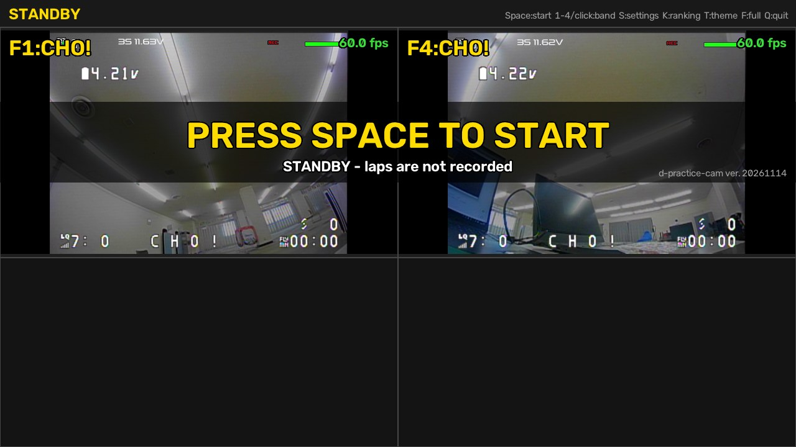
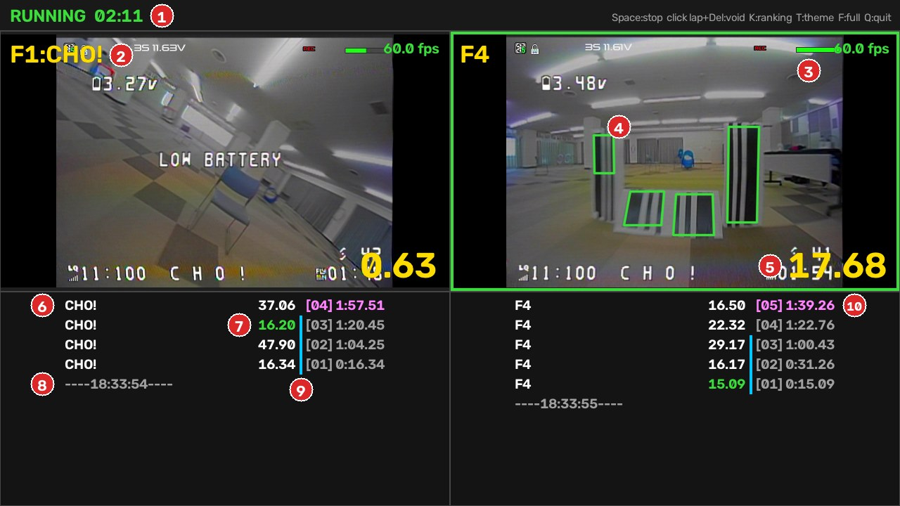
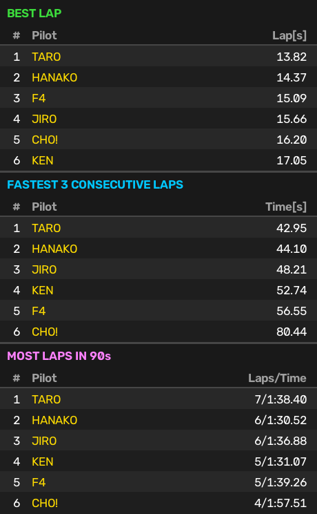
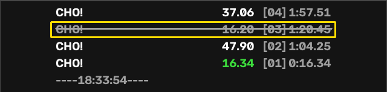
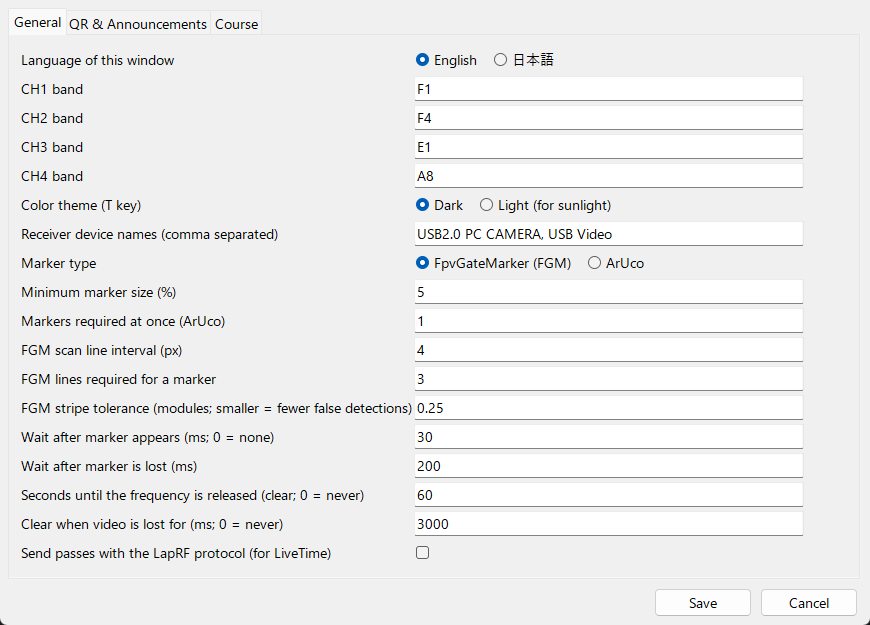
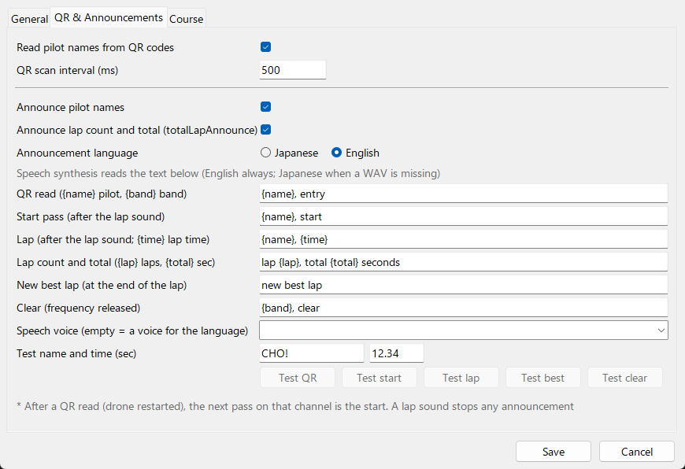
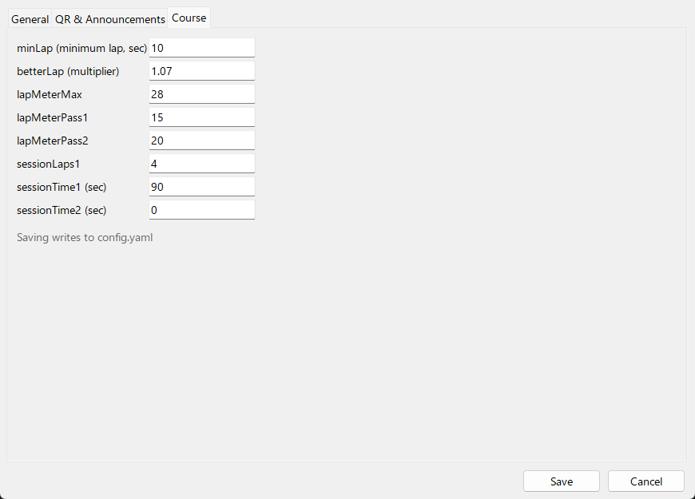

# d-practice-cam

[日本語](README_jp.md)

A lap timer for FPV drones. It watches the video from USB video receivers (5.8 GHz, up to 4) for markers on the gate, times each lap, and announces the pilot name and lap time.

This app is made for practice sessions. It has no race features, and none are planned.

For Windows 10/11.

There are two downloads on the [Releases](https://github.com/chibaron/d-practice-cam/releases/latest) page:

- `d-practice-cam_en_<date>.zip` (English): Announcements use Windows speech synthesis.
- `d-practice-cam_ja_<date>.zip` (Japanese): The English version plus the Japanese announcement voice (VOICEVOX, Shikoku Metan). Announcements start in Japanese.

## What's in the folder

```
d-practice-cam\
  d-practice-cam.exe    Start the app
  debug.bat            Start the app and show the log (for troubleshooting)
  config.yaml          Settings (created at startup if missing)
  README_jp.md         This guide in Japanese
  docs\images\         Images for this guide
  sound\               Lap, error, and start sounds (sound\voice\ is the Japanese voice, Japanese version only)
  _internal\           The app itself (do not touch)
```

Put the whole folder anywhere you like. Keep `_internal\` and `sound\` in the same folder as the exe.

## Getting started

1. **Connect the receivers**: Connect up to 4 USB video receivers. Several receivers on one USB hub may not show video, so use one USB port per receiver if you can.
2. **Put up the markers**: The app uses **FpvGateMarker (FGM)** by default. For the marker images and how to make and mount them (left and right posts, or a ring for a round gate), see [FpvGateMarker](https://github.com/chibaron/fpv-gate-marker). Ready-to-print images (left and right posts, and a ring for a 600 mm round gate) are in its [print/](https://github.com/chibaron/fpv-gate-marker/tree/main/print) folder.
   - **ArUco markers (the same as TinyViewPlus) also work.** Select ArUco under `Marker type` in the settings (S key). Gates already marked for TinyViewPlus work as they are.
3. Start `d-practice-cam.exe`.

If your receiver's device name does not contain `USB2.0 PC CAMERA` or `USB Video`, enter it under `Receiver device names` in the settings (S key).

## How to use

### 1. Start the app (standby)



At startup the app finds the receivers, shows their video, and goes into **standby**. Laps are not timed in standby ("PRESS SPACE TO START" appears in the center of the screen). Receivers are detected automatically when you plug them in or remove them.

- **Set the bands**: The top left of each video shows that channel's band (F1, F4, etc.). If it is wrong, press 1-4 or click the video and choose again (standby only). Bands are remembered for each USB port a receiver is connected to, so they do not get swapped when you unplug and reconnect receivers.
- **Check the gate**: A green frame appears when a marker is visible, which helps you check the gate position. A marker outlined in yellow was found but does not count as a gate yet (for FGM: for example, only one side is visible; for ArUco: fewer markers than required), so passing it is not timed.

### 2. Press Space to start timing

**Press Space to start timing.** Press it again to return to standby. Channels are shown side by side, and each channel's laps are listed below its video.



| No. | What it shows |
| --- | --- |
| 1 | The state (`STANDBY` or `RUNNING`) and the time since timing started |
| 2 | The band. If a pilot name was read from a QR code, it is added, like `F1:CHO!` (see [Pilot names](#pilot-names-qr-codes)) |
| 3 | The capture frame rate. Green is normal (see [Troubleshooting](#troubleshooting)) |
| 4 | While a marker is visible, a green frame is drawn around the video and the marker |
| 5 | A timer that counts up from the last pass and goes back to 0 at each pass (`--.--` before the start) |
| 6 | Laps, newest first: pilot name, lap time, and `[lap count] total time` since the start |
| 7 | A green lap is that pilot's best lap today (the one shown as BEST LAP in the ranking window) |
| 8 | `----HH:MM:SS----` is the time of a start, so it separates sessions |
| 9 | The 3 laps with a light blue line are that pilot's best 3 consecutive laps today (the FASTEST 3 CONSECUTIVE LAPS record in the ranking window) |
| 10 | A pink `[lap count] total time` is that pilot's most-laps-in-90-seconds record today (the same numbers as MOST LAPS IN 90s in the ranking window) |

- The first pass on each channel is the start. Every pass after that times a lap. A pass at or below `minLap` (the minimum lap time) plays an error sound and is not counted (no sound if it is 3 seconds or less after the last counted pass, such as the same gate seen twice).
- 60 seconds after the last pass (the default; you can change it on the General tab in the settings), the channel's frequency is released and it is "cleared". The next pass is a new start.
- While there is no video (static, or the receiver's blue or black screen), the app does not look for markers. Video is checked every second while there is video and every 0.1 seconds while there is none. If the loss lasts 3 seconds after it is noticed (the default; 0 = never), the channel is cleared, up to about 4 seconds after the video is lost. A shorter loss of video does not end the session.
- **Seeing older laps**: The text size of the list stays the same; a larger window (or full screen) shows more rows. To see older laps that do not fit, turn the mouse wheel over that channel's list, or use the scroll bar at its right edge (drag the bar, or click above or below it to move one page). While you are looking at older laps, new laps do not move the list; scroll back up to go to the newest.
- **Lap records**: Every pass of the day is saved in `laps/laps_YYYY-MM-DD.jsonl` next to the exe (one file per day, a few hundred KB). Today's laps and ranking are shown again after a restart. Files from earlier days are kept; delete them if you do not need them.

### 3. See the ranking (K key)



A separate window shows three tables, from top to bottom. Press K to open or close it. A channel with no pilot name is listed under its band (`F4` in the example above). The color of each table name (green, light blue, pink) is the color used to mark that record's laps in the lap list on the main screen.

| Table | What it shows |
| --- | --- |
| BEST LAP | Each pilot's best lap (fastest first) |
| FASTEST 3 CONSECUTIVE LAPS | The best 3 consecutive laps (fastest total first). The 3 laps must be in the same session, from a start until the channel is reset or timing stops; laps from different sessions do not count together |
| MOST LAPS IN 90s | Most laps in 90 seconds, shown as laps/time: `5/1:39.26` is 5 laps in 1 minute 39.26 seconds. Most laps first, and for equal laps, shortest time first. It counts laps and time up to the first pass after 90 seconds from the start (a lap in progress at 90 seconds counts if it is finished) |

The ranking is worked out from today's laps, so it is the same after a restart. It starts empty when the date changes.

### 4. Remove a wrong lap



If a lap was timed wrongly (a false pass or a missed pass), you can leave it out of the ranking.

1. Click that row in the lap list to select it (an orange frame)
2. Press Delete (or Backspace)

The lap stays in the list, grayed out and crossed through, and is left out of the ranking (the next best record moves up). Press Delete again to bring it back. This works while timing too. The lap count and total of the other rows are not changed. If short false laps happen often, raise `minLap`.

### Keys

| Key | Action |
| --- | --- |
| Space | Start / stop timing (a sound plays at the start) |
| 1-4 / click a video | Change that channel's band (E1, F4, etc.; standby only) |
| S | Settings (standby only) |
| K | Open / close the ranking window |
| Click a lap, then Delete | Mark that lap as wrong / bring it back (works while timing too) |
| T | Switch the colors: dark (the default) / light (easy to read in sunlight) |
| F | Full screen (Esc to exit) |
| R | Search for receivers again (standby only; normally automatic) |
| Q | Quit (Esc does not quit) |

## Pilot names (QR codes)

Show the pilot name as a QR code on the Betaflight startup screen to time laps for each pilot. To create the QR code, see [QR Boot Logo Maker](https://chibaron.github.io/qr-boot-logo-maker/).

The app reads the QR code that appears in the video when a drone starts up and uses it as that channel's pilot name. It appears on screen like `F1:CHO!`.

- When a QR code is read, the app announces the entry, and the next pass is the start. If you restart the drone, it enters again right away, even with the same name.
- A channel with no QR code read, or one that was cleared because no one passed, uses the band name (F1, etc.).

## Sounds and announcements

| When | What you hear |
| --- | --- |
| Timing starts | Start sound |
| QR code read | "CHO!, entry" |
| Start (first pass) | Lap sound, then "CHO!, start" |
| Lap | Lap sound, then "CHO!, 11.0, lap 3, total 35 seconds" (laps of 60 seconds or more play the sound only) |
| Lap that sets a new best lap | A different lap sound, and "new best lap" at the end of the lap announcement |
| Pass at or below `minLap` | Error sound (none at 3 seconds or less) |
| No pass until the release time (default 60 seconds), or video lost (default 3 seconds) | "F1, clear" |

- If someone passes during an announcement, the announcement stops and the lap sound plays first.
- The English version announces in English with Windows speech synthesis. An English voice must be installed.
- The Japanese version announces in Japanese with the voice in `sound\voice\`. You can switch the language under `Announcement language` on the QR & Announcements tab. Without `sound\voice\`, Japanese uses Windows speech synthesis (a Japanese voice must be installed in Windows).
- **Japanese voice (Japanese version)**: The VOICEVOX (Shikoku Metan) wav files for set phrases are in `sound\voice\`. Pilot names go in `sound\pilot\`.
- **Pilot names are not included** (only `CHO!`, `GORI`, and `KUMACHAN` are in `sound\pilot\` of the Japanese version). In the Japanese version, the app makes `sound\pilot\<name>.wav` for a name that has no wav. If VOICEVOX is running on this PC, it is made in the VOICEVOX voice (Shikoku Metan, the same as `sound\voice\`); if not, in the Windows speech voice (see below).
- `totalLapAnnounce` on the Course tab sets whether the lap count and total time are read.
- To turn off all sounds, set `enabled` to `false` under `sound` in `config.yaml`.

### Reading pilot names in the VOICEVOX voice

This is for Japanese announcements only (English announcements do not use wav files and are read with Windows speech synthesis).

**The easy way: keep VOICEVOX running.** If [VOICEVOX](https://voicevox.hiroshiba.jp/) is running on the same PC as the app, the app makes `sound\pilot\<name>.wav` with VOICEVOX (四国めたん / Shikoku Metan, ノーマル / Normal, speed 1.2) the first time a name with no wav is announced. If VOICEVOX is not running, the wav is made in the Windows speech voice.

- A wav is made only once. To change a name made in the Windows voice to the VOICEVOX voice, start VOICEVOX and delete that wav in `sound\pilot\`. It is made again at the next announcement.
- If the name is read wrongly, make the wav yourself as follows.

**Making the wav yourself:**

1. Install and start [VOICEVOX](https://voicevox.hiroshiba.jp/), and choose **四国めたん (Shikoku Metan), ノーマル (Normal)**. The voice in `sound\voice\` uses a speed of 1.2.
2. Type the pilot name, and export it as a wav. Keep the default output settings (mono, 24 kHz). With other settings, the name and the following words may not join smoothly.
3. Name the file exactly as the name in the QR code, like `CHO!.wav`, and put it in `sound\pilot\` next to the exe. If a wav made with the Windows voice is already there, overwrite it.

## LapRF output (LiveTime, etc.)

The app can send gate passes with a LapRF-compatible protocol to software that supports LapRF, such as LiveTime. This is off by default.

1. Turn on `Send passes with the LapRF protocol` on the General tab in the settings. Windows may ask you to allow network access.
2. In the other software, add a LapRF timer with this PC's IP address and port 5403.
3. Press Space to start timing. Passes are sent only while timing. A pass at or below `minLap` is not sent, so set `minLap` no higher than the minimum lap time in the other software.

Channels use the bands set in this app. Changing frequencies from the other software has no effect here.

## Settings

Change everyday settings in the **settings dialog (S key)**, available in standby. Settings are saved in `config.yaml` next to the exe.

### General



| Item | Default | Description |
| --- | --- | --- |
| `CH1 band` to `CH4 band` | | Band of each channel (you can also change it with keys 1-4 or by clicking the video) |
| `Color theme (T key)` | Dark | Color theme. Light uses a white background that is easier to read in sunlight |
| `Receiver device names` | | Names of video devices to use as receivers (comma separated; part of the name is enough) |
| `Marker type` | FGM | Marker type (FGM / ArUco) |
| `Minimum marker size (%)` | 5 | Minimum marker size relative to the video height. Smaller markers are ignored (avoids reacting to distant gates) |
| `Markers required at once` | 1 | Number of ArUco markers that must be visible at once (ArUco only) |
| `FGM scan line interval (px)` | 4 | Spacing of the horizontal lines used to search for FGM |
| `FGM lines required for a marker` | 3 | An FGM is found when it is seen on this many consecutive lines |
| `FGM stripe tolerance` | 0.25 | How far the FGM stripe spacing may be off. Smaller rejects more false detections but makes distant markers harder to read |
| `Wait after marker appears (ms)` | 30 | A marker counts as visible after it is seen this long (ignores false detections). 0 = immediately |
| `Wait after marker is lost (ms)` | 200 | Time after the marker disappears before the pass is confirmed |
| `Seconds until the frequency is released` | 60 | If no pass for this many seconds, the channel is cleared and returns to the band name. 0 = never |
| `Clear when video is lost for (ms)` | 3000 | Clear the channel when there is no video for this long. 0 = never |
| `Send passes with the LapRF protocol` | Off | Send passes with a LapRF-compatible protocol on TCP port 5403 (see [LapRF output](#laprf-output-livetime-etc)) |

### QR & Announcements



| Item | Default | Description |
| --- | --- | --- |
| `Read pilot names from QR codes` | On | Read pilot names from QR codes |
| `QR scan interval (ms)` | 500 | How often to look for QR codes (shorter uses more CPU) |
| `Announce pilot names` | On | Make announcements |
| `Announcement language` | English | Announcement language (English / Japanese) |
| `QR read` / `Start pass` / `Lap` / `Lap count and total` / `New best lap` / `Clear` | | Text read by speech synthesis. `{name}` pilot name, `{band}` band, `{time}` lap time, `{lap}` lap count, `{total}` total seconds |
| `Speech voice` | Empty | Part of the speech voice name (empty = a voice for the language) |
| `Test name and time (sec)` | | Name and time used by the `Test ...` buttons |

### Course



| Item | Default | Description |
| --- | --- | --- |
| `minLap` | 10 | Laps at or below this (seconds) are not counted |
| `totalLapAnnounce` | On | Add the lap count and total time to lap announcements |
| `sessionTime1` | 90 | Seconds for MOST LAPS IN 90s in the ranking |

Other items (`betterLap`, `lapMeterMax`, and so on) are not used by this app.

## Troubleshooting

- **Version**: The version is the build date (for example `20261110`). It appears in the window title, at the bottom right of the standby banner, and at the top of the log. Please include it when you report a problem.
- **Log**: Written to `d-practice-cam.log` next to the exe.
- **debug.bat**: Starts the app with a console window showing a detailed log. Closing that window also closes the app.
- **No video from a receiver (NO SIGNAL)**: Check that no other app (OBS, or a second copy of d-practice-cam) is using the receiver. Connecting directly instead of through a USB hub may help.
- **Receiver not found**: Start with debug.bat and the log lists the video devices found. Enter the name under `Receiver device names` in the settings.
- **Some passes are not detected**: Check the fps at the top right of each video. It should be close to the receiver's frame rate (about 30 or 60). It is green at 28 or more and red at 20 or less. If it is lower, the PC is not fast enough. Try using fewer receivers (channels).

## License and credits

- This app is released under the MIT License (see `LICENSE`).
- This app uses open source software such as OpenCV, Python, and numpy. Their licenses are in `THIRD_PARTY_LICENSES\`.
- Japanese announcement voice (`sound\voice\`, Japanese version): VOICEVOX:四国めたん
- Sound effects (`sound\lap.wav`, `bestlap.wav`, `errorlap.wav`, `boot.wav`): Made for this app and can be used on the same terms as the app.

## For developers

How to run from source and build the exe. The specification is in [docs/spec.md](docs/spec.md) (Japanese).

```
pip install -r requirements.txt
python main.py                      # Run from source (--video a.mp4 lets you try it without receivers)
python tests/test_app.py            # Check operation with synthetic video
python tools/make_voice.py          # Make the Japanese voice (sound\voice\) with VOICEVOX (start VOICEVOX first)
pip install pyinstaller
python tools/build_exe.py           # Build the exe in dist\d-practice-cam\ (about 300 MB)
python tools/build_exe.py --public  # Build the public zips (dist\d-practice-cam_en_<date>.zip and dist\d-practice-cam_ja_<date>.zip)
```

`tools/build_exe.py` places `sound\` (including `sound\voice\`), `config.yaml` (if present), `debug.bat`, `README.md`, and `README_jp.md` next to the exe. The public build (`--public`) leaves out `config.yaml`, and only the Japanese zip has `sound\voice\`. When `config.yaml` does not exist yet and `sound\voice\` has wav files, the app starts with Japanese announcements.

The Japanese voice wav files are not in this repository (they are in the Japanese zip only). To build the Japanese version from source, start [VOICEVOX](https://voicevox.hiroshiba.jp/) and run `python tools/make_voice.py`. It makes all the wav files in `sound\voice\` (Shikoku Metan, Normal, speed 1.2). Credit "VOICEVOX:四国めたん" when you distribute them.
`sound\voice\` (voice wav files, about 71 MB) and `config.yaml` are not in Git.
