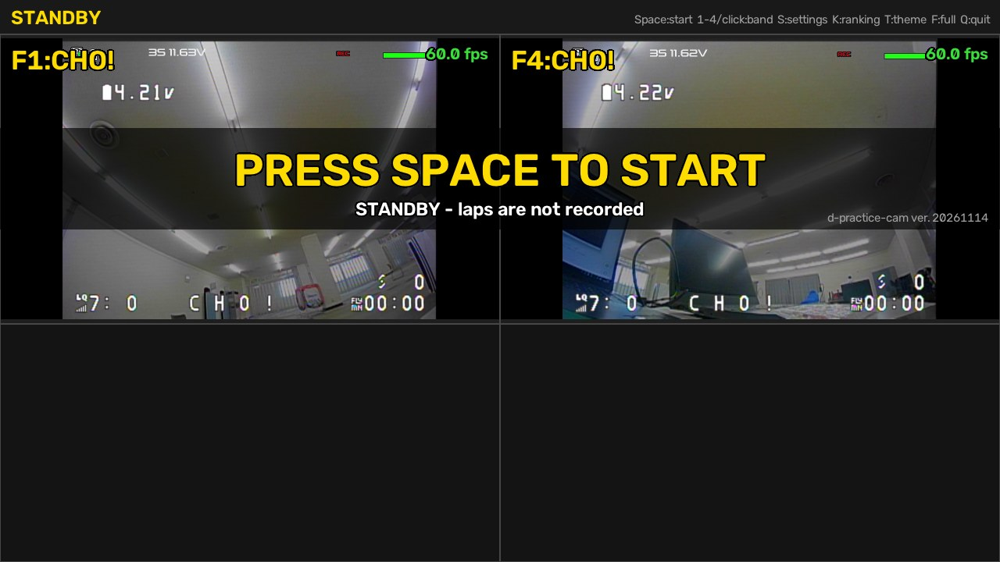
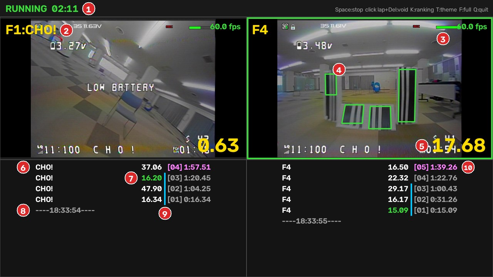
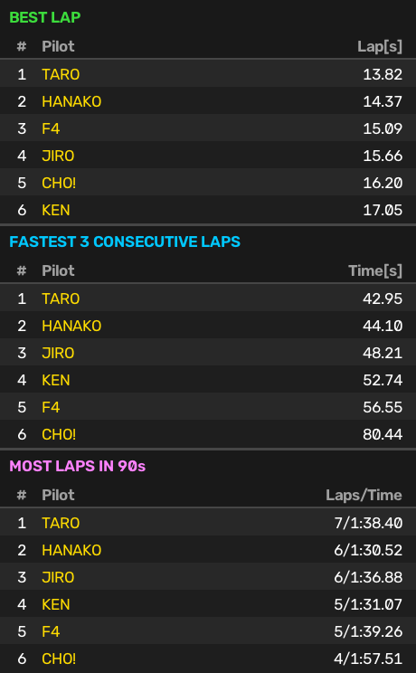
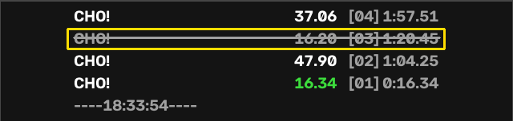
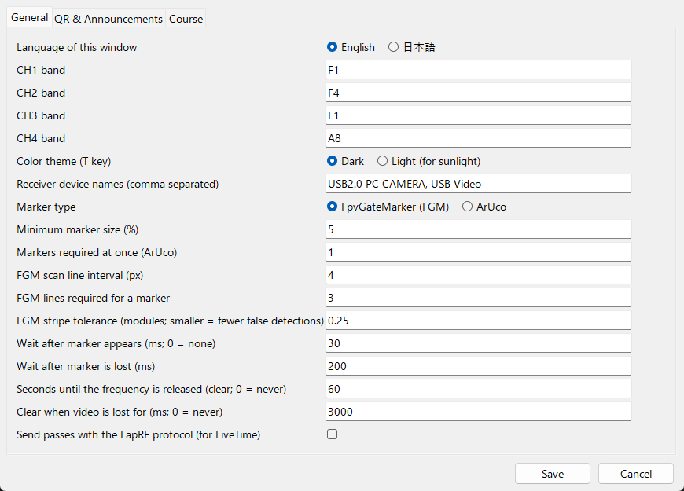
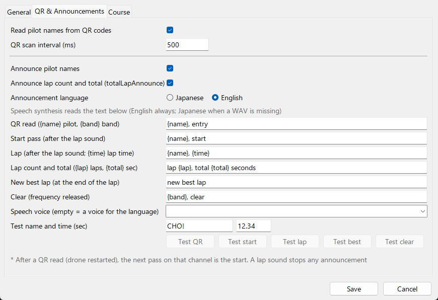
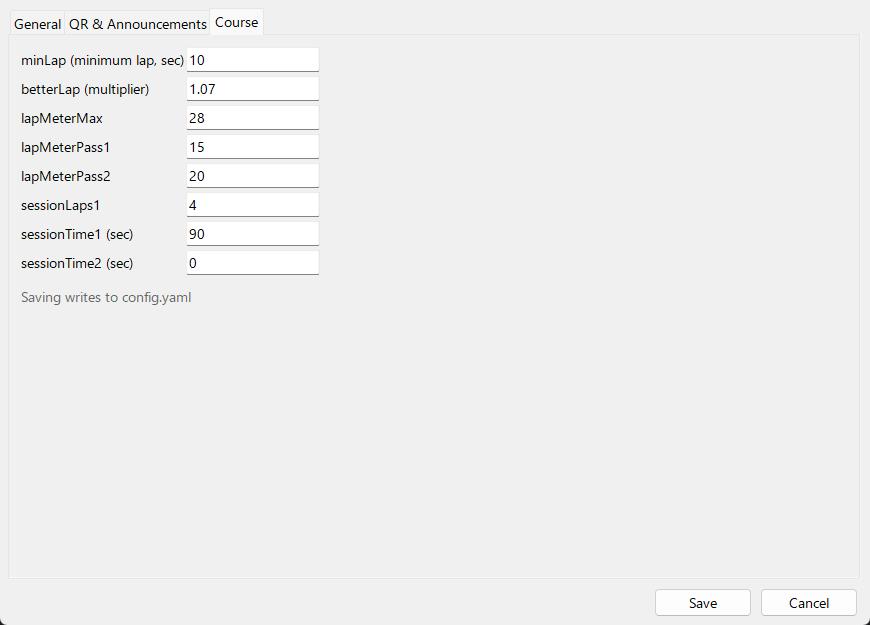

# d-practice-cam

[English](README.md)

FPVドローン用のラップタイマーです。USB映像受信器（5.8GHz、最大4台）で受けた映像から、ゲートに貼ったマーカーの通過を検出してラップを計測し、
パイロット名とタイムをアナウンスします。

練習会用のアプリです。レース機能は搭載しておらず、今後も搭載する予定はありません。

Windows 10/11 用です。

[Releases](https://github.com/chibaron/d-practice-cam/releases/latest) のページから、どちらかをダウンロードしてください。配布は2種類です。

- `d-practice-cam_ja_日付.zip`（日本語版）: 英語版に日本語のアナウンスの声（VOICEVOX、四国めたん）を入れたものです。アナウンスは日本語で始まります
- `d-practice-cam_en_日付.zip`（英語版）: アナウンスは Windows の音声合成の英語です

## フォルダの中身

```
d-practice-cam\
  d-practice-cam.exe    起動する
  debug.bat               ログを見ながら起動する（困ったとき）
  config.yaml             設定（無ければ起動時に作られる）
  README.md               この説明の英語版
  docs\images\            この説明の画像
  sound\                  ラップ音・エラー音・起動音（sound\voice\ は日本語の声。日本語版のみ）
  _internal\              アプリ本体（触らない）
```

フォルダごと好きな場所に置いて使います。`_internal\` と `sound\` は exe と同じフォルダに置いたままにしてください。

## はじめに

1. **受信器をつなぐ**: USB映像受信器を最大4台つなぎます。1つの USB ハブに複数台つなぐと映らないことがあるので、USB ポート1つに1台をおすすめします
2. **マーカーを貼る**: 既定では **FpvGateMarker（FGM）** を使います。マーカーの画像と作り方・貼り方（ゲートの左右の柱、円形ゲートの輪）は [FpvGateMarker](https://github.com/chibaron/fpv-gate-marker) を見てください。印刷用の画像（左右の柱用と、内径600mm の円形ゲート用の輪）はその [print/](https://github.com/chibaron/fpv-gate-marker/tree/main/print) にあります
   - **ArUco マーカー（TinyViewPlus と共通）も使えます。** 設定画面（S キー）の `Marker type` で ArUco を選びます。TinyViewPlus 用に貼ってあるゲートのマーカーをそのまま使えます
3. `d-practice-cam.exe` を起動します

受信器のデバイス名に `USB2.0 PC CAMERA` も `USB Video` も含まれないときは、設定画面（S キー）の `Receiver device names` に入れてください。
## 使い方

### 1. 起動する（待機中）



起動すると受信器を自動で探して映像を出し、**待機中**になります。待機中はラップを計測しません（画面中央に「PRESS SPACE TO START」）。受信器の抜き差しは自動で見つけます。

- **バンドを合わせる**: 各映像の左上がその ch のバンド（F1、F4 など）です。違っていたら、1〜4 キーを押すか映像をクリックして選び直します（待機中のみ）。バンドは受信器をつないでいる USB ポートごとに覚えます。抜き差ししても入れ替わりません
- **ゲートを確かめる**: マーカーが見えると緑の枠が出るので、ゲートの位置の確認に使えます。マーカーが黄色で囲まれているときは、見つけてはいるもののゲートとしては認めていない状態で（FGM なら片方だけ見えているときなど。ArUco なら必要な数に足りない）、通過しても計測しません

### 2. Space で計測を始める

**Space で計測を開始**し、もう一度押すと待機中に戻ります。ch は横に並び、各 ch の映像の下にその ch のタイムが出ます。



| 番号 | 内容 |
| --- | --- |
| 1 | 状態（待機中は `STANDBY`、計測中は `RUNNING`）と、計測を始めてからの時間 |
| 2 | バンド名。QR コードでパイロット名を読んでいれば `F1:CHO!` のように名前が付きます（[パイロット名](#パイロット名qrコード)） |
| 3 | 映像の取り込みの fps。緑なら正常です（[困ったとき](#困ったとき)） |
| 4 | マーカーが見えている間は、映像の外周とマーカーに緑の枠が出ます |
| 5 | 最後の通過から数え上げるタイマー。ゲートを通過すると 0 に戻ります（スタート前は `--.--`） |
| 6 | タイム。新しい順に、パイロット名、ラップ、`[周回数] トータル`（スタートから数えたもの） |
| 7 | 緑のラップは、そのパイロットの今日のベストラップ（ランキングの BEST LAP に載っているラップ） |
| 8 | `----HH:MM:SS----` はスタートした時刻で、セッションの区切りです |
| 9 | 水色の縦線の付いた3周は、そのパイロットの今日の3周連続のベスト（ランキングの FASTEST 3 CONSECUTIVE LAPS の記録） |
| 10 | ピンクの `[周回数] トータル` は、そのパイロットの今日の90秒の周回数の記録（ランキングの MOST LAPS IN 90s と同じ数字） |

- 各chの最初の通過がスタート（起点）で、そこから通過ごとにラップを計測します。`minLap`（最小ラップ）以下の通過はエラー音を鳴らして数えません（前に数えた通過から3秒以下なら、同じゲートの二重検出などとして音も鳴らしません）
- 最後の通過から60秒（既定値。設定画面の General タブで変えられます）たつと、そのchの周波数を解放して「クリア」になり、次の通過がまたスタートになります
- 映像が無い間（砂嵐や、受信器の青画面・黒画面）はマーカーを探しません。映像の確認は、映像がある間は1秒ごと、無い間は0.1秒ごとです。映像が無いと分かってから3秒（既定値。0でしない）続くとクリアになります（映像が無くなってから最大で約4秒）。それより短い途切れならセッションは続きます
- **古いタイムを見る**: 一覧の文字の大きさは変わらず、ウィンドウを大きくする（全画面にする）ほど多くの行が出ます。入りきらない古いタイムは、そのchの一覧の上でマウスホイールを回すか、右端のスクロールバーを使うと見られます（つまみをドラッグするか、つまみの上下をクリックすると1画面ずつ動きます）。古い所を見ている間は新しいタイムが来ても表示がずれないので、上へスクロールして最新に戻してください
- **ラップの記録**: その日の全部の通過を、exe の隣の `laps/laps_YYYY-MM-DD.jsonl` に残します（1日1ファイル、数百KB）。その日のタイムとランキングは、アプリを起動し直しても出ます。前の日のファイルは消さないので、要らなければ消してください

### 3. ランキングを見る（K キー）



別ウィンドウに、上から順に3つの表を出します。K キーで開く / 閉じるを切り替えます。パイロット名を読んでいない ch は、バンド名（上の例の `F4`）で載ります。表の名前の色（緑・水色・ピンク）は、メイン画面のタイムの一覧でその記録のラップに付く印の色と同じです。

| 表 | 内容 |
| --- | --- |
| BEST LAP | パイロットごとのベストラップ（速い順） |
| FASTEST 3 CONSECUTIVE LAPS | 3周連続のベスト（合計の速い順）。同じセッション（スタートから、そのchがリセットされるか計測を止めるまで）の中で続けて飛んだ3周だけが対象で、セッションを跨いだ周は合わせません |
| MOST LAPS IN 90s | 90秒の周回数。`5/1:39.26` = 5周で1分39秒26。周回数の多い順、同じならタイムの短い順。スタートから90秒を過ぎた最初の通過までの周回数とタイムです（90秒の時点で走っている周も、ゴールすれば数えます） |

ランキングはその日のラップから計算するので、アプリを起動し直しても同じです。日付が変わると空になります。

### 4. ミス計測のラップを消す



誤検出や通過の見逃しで間違ったラップは、ランキングから外せます。

1. タイムの一覧で、その行をクリックして選びます（オレンジの枠）
2. Delete キー（Backspace でも可）を押します

そのラップは一覧に灰色の取り消し線で残り、ランキングから外れます（2番目の記録が繰り上がります）。もう一度 Delete で戻せます。計測中でもできます。ほかの行の周回数とトータルは変わりません。短い誤検出が多いときは `minLap` を上げてください。

### キーの一覧

| キー | 操作 |
| --- | --- |
| Space | 計測の開始 / 停止（開始時に起動音） |
| 1〜4 / 映像をクリック | そのchのバンド（E1、F4 など）を変える（待機中のみ） |
| S | 設定画面（待機中のみ） |
| K | ランキングウィンドウを開く / 閉じる |
| ラップの行をクリック → Delete | そのラップを無効にする / 戻す（ミス計測。計測中もできる） |
| T | 配色の切り替え: ダーク（既定）/ 明るい配色（日光の下で見やすい） |
| F | 全画面（Esc で戻る） |
| R | 受信器を探し直す（待機中のみ。ふだんは自動） |
| Q | 終了（Esc では終了しません） |

## パイロット名（QRコード）

Betaflight の起動画面にパイロット名を QR コードで表示すると、パイロットごとにタイムを計測できます。QR コードの作り方は[QR Boot Logo Maker](https://chibaron.github.io/qr-boot-logo-maker/)を参照してください。

ドローンを起動したときに映像に出る QR コードを読み取り、そのchのパイロット名にします。画面には `F1:CHO!` のように出ます。

- QR を読んだら「〇〇、エントリー」とアナウンスし、次の通過がスタートになります。機体を起動し直せば、同じ名前でもすぐにまたエントリーになります
- QR を読んでいないchや、通過が無くてクリアになったchは、バンド名（F1 など）で扱います

## 音とアナウンス

アナウンスは**既定で英語**です。日本語にするには、設定画面の QR & Announcements タブの `Announcement language` で `Japanese` を選びます。下の表の文は日本語を選んだときのものです。

| とき | 鳴るもの |
| --- | --- |
| 計測開始 | 起動音 |
| QR を読んだ | 「〇〇、エントリー」 |
| スタート（起点の通過） | ラップ音 →「〇〇、スタート」 |
| 周回 | ラップ音 →「〇〇、11.0、3周、トータル35秒」（60秒以上のラップは音だけ） |
| 周回でベストラップを更新した | ラップ音がベスト用の音に変わり、周回のアナウンスの最後に「ベストラップ更新」 |
| `minLap` 以下の通過 | エラー音（3秒以下は鳴らさない） |
| 通過が無いまま解放の秒数（既定60秒）たった、または映像が無くなった（既定3秒） | 「エフワン、クリア」 |

- 日本語版は `sound\voice\` の声で日本語のアナウンスをします。言語は設定画面の QR & Announcements タブの `Announcement language` で切り替えられます。`sound\voice\` が無いときの日本語は Windows の音声合成で読みます（Windows に日本語の声が必要です）
- **日本語の声（日本語版）**: VOICEVOX（四国めたん）で作った決まった言葉の wav は `sound\voice\` に入っています。パイロットの名前は `sound\pilot\` に置きます
- **パイロットの名前は入っていません**（日本語版の `sound\pilot\` には `CHO!`・`GORI`・`KUMACHAN` だけ入っています）。日本語版では、wav が無い名前はアプリが `sound\pilot\名前.wav` を作ります。この PC で VOICEVOX が起動していれば VOICEVOX の声（`sound\voice\` と同じ四国めたん）で、起動していなければ Windows の音声合成の声で作ります（下の説明）
- アナウンスの途中で誰かが通過したら、アナウンスを止めてラップ音を先に鳴らします
- 英語のアナウンスは上の wav を使わず、Windows の音声合成で読みます（英語の声が入っている必要があります）
- 周回数とトータルを読むかどうかは、設定画面の Course タブの `totalLapAnnounce` で変えられます
- 音を全部消すときは `config.yaml` の `sound` の `enabled` を `false` にします

### パイロットの名前を VOICEVOX の声で読ませる

日本語のアナウンスのときだけ使います（英語のアナウンスは wav を使わず、Windows の音声合成で読みます）。

**かんたんな方法: VOICEVOX を起動しておく。** アプリと同じ PC で [VOICEVOX](https://voicevox.hiroshiba.jp/) を起動しておくと、wav の無い名前を初めてアナウンスするときに、アプリが VOICEVOX（四国めたん ノーマル、話速 1.2）で `sound\pilot\名前.wav` を作ります。VOICEVOX が起動していなければ、Windows の音声合成の声で作ります。

- 一度作った wav は作り直しません。Windows の声で作った名前を VOICEVOX の声にしたいときは、VOICEVOX を起動してから `sound\pilot\` のその wav を消してください。次のアナウンスで作り直します
- 読み方が違うとき（英字の名前など）は、下の手順で自分で wav を作って入れてください

**自分で作る方法:**

1. [VOICEVOX](https://voicevox.hiroshiba.jp/) を入れて起動し、**四国めたん（ノーマル）** を選びます。`sound\voice\` は話速 1.2 で作っています
2. パイロットの名前を入力して、wav で書き出します。書き出しの設定は既定のまま（モノラル、24kHz）にしてください。ほかの設定だと、名前とその後の言葉がうまくつながらないことがあります
3. ファイル名を QR コードの名前と同じ（例: `CHO!.wav`）にして、exe の隣の `sound\pilot\` に置きます。Windows の声で作った wav がすでにあれば、上書きしてください

## LapRF での通知（LiveTime など）

ゲートの通過を LapRF 互換プロトコルで、LiveTime などの LapRF に対応したソフトに知らせることができます。既定はオフです。

1. 設定画面の General タブで `Send passes with the LapRF protocol` をオンにします。Windows からネットワークの許可を求められることがあります
2. 相手のソフトで、この PC の IP アドレスとポート 5403 の LapRF タイマーを追加します
3. Space で計測を始めます。通過を送るのは計測中だけです。`minLap` 以下の通過は送らないので、`minLap` は相手のソフトの最小ラップタイム以下にしてください

ch はこのアプリで設定したバンドを使います。相手のソフトから周波数を変えても、こちらには反映されません。

## 設定

ふだんの設定は **S キーの設定画面**で変えます（待機中のみ）。設定画面の表示は英語です。設定は exe の隣の `config.yaml` に保存されます。

### General



| 項目 | 既定 | 内容 |
| --- | --- | --- |
| `CH1 band`〜`CH4 band` | | 各 ch のバンド（1〜4 キー・映像クリックでも変えられます） |
| `Color theme (T key)` | Dark | 配色。Light は白い地で日光の下でも読みやすい |
| `Receiver device names` | | 受信器として使う映像デバイスの名前（カンマ区切り、名前の一部でよい） |
| `Marker type` | FGM | マーカーの種類（FGM / ArUco） |
| `Minimum marker size (%)` | 5 | 映像の高さに対するマーカーの最小の大きさ。小さいものは無視します（遠くのゲートの誤反応対策） |
| `Markers required at once` | 1 | 同時に見えている必要がある ArUco マーカーの数（ArUco のみ） |
| `FGM scan line interval (px)` | 4 | FGM を探す横線の間隔 |
| `FGM lines required for a marker` | 3 | この本数の横線で続けて見つかったら FGM とする |
| `FGM stripe tolerance` | 0.25 | FGM の縞の間隔のずれの許容。小さいほど誤検出が減るが、遠くのマーカーは読みにくい |
| `Wait after marker appears (ms)` | 30 | この時間続けて見えたら「見えた」とする（誤検出対策）。0 ですぐ |
| `Wait after marker is lost (ms)` | 200 | マーカーが見えなくなってから通過を確定するまでの時間 |
| `Seconds until the frequency is released` | 60 | この秒数ゲートを通らなければ、その ch をクリアしてバンド名に戻す。0 でしない |
| `Clear when video is lost for (ms)` | 3000 | 映像が無い状態がこの時間続いたらクリアする。0 でしない |
| `Send passes with the LapRF protocol` | オフ | LapRF 互換プロトコル（TCP ポート 5403）で通過を知らせる（[LapRF での通知](#laprf-での通知livetime-など)） |

### QR & Announcements



| 項目 | 既定 | 内容 |
| --- | --- | --- |
| `Read pilot names from QR codes` | オン | QR コードからパイロット名を読む |
| `QR scan interval (ms)` | 500 | QR を探す間隔（短いほど CPU を使う） |
| `Announce pilot names` | オン | アナウンスをする |
| `Announcement language` | English | アナウンスの言語（英語 / 日本語） |
| `QR read` / `Start pass` / `Lap` / `Lap count and total` / `New best lap` / `Clear` | | 音声合成で読む文。`{name}` パイロット名、`{band}` バンド、`{time}` ラップ、`{lap}` 周回数、`{total}` トータル秒 |
| `Speech voice` | 空 | 音声合成の声の名前の一部（空なら言語に合った声） |
| `Test name and time (sec)` | | `Test ...` のボタンで聞くときの名前とタイム |

### Course



| 項目 | 既定 | 内容 |
| --- | --- | --- |
| `minLap` | 10 | これ以下のラップ（秒）は数えない |
| `totalLapAnnounce` | オン | ラップのアナウンスに周回数とトータルを付ける |
| `sessionTime1` | 90 | ランキングの MOST LAPS IN 90s の秒数 |

ほかの項目（`betterLap`、`lapMeterMax` など）はこのアプリでは使いません。

## 困ったとき

- **バージョン**: exe を作った日付です（例: `20261110`）。ウィンドウのタイトル、待機中の帯の右下、ログの最初に出ます。問い合わせのときは添えてください
- **ログ**: exe の隣の `d-practice-cam.log` に記録されます
- **debug.bat**: 黒い画面（コンソール）を出して、詳しいログを見ながら起動します。この画面を閉じるとアプリも終了します
- **受信器が映らない（NO SIGNAL）**: 別のアプリ（OBS や、もう1つ起動した d-practice-cam など）が受信器を使っていないか確認してください。USB ハブをやめて直接つなぐと直ることがあります
- **受信器が見つからない**: debug.bat で起動すると、見つかった映像デバイスの名前がログに出ます。その名前を設定画面の `Receiver device names` に入れてください
- **マーカーの通過を検知できないときがある**: 映像の右上の fps が、受信器のフレームレート（30 や 60 くらい）になっているか見てください。28以上は緑、20以下は赤で出ます。届いていないときは PC の性能が足りていないので、使う受信器（ch）を減らすなどしてみてください

## ライセンス・クレジット

- このアプリは MIT ライセンスです（`LICENSE`）
- このアプリは OpenCV、Python、numpy などのオープンソースソフトウェアを使っています。各ライセンスは `THIRD_PARTY_LICENSES\` にあります
- 日本語アナウンスの声（日本語版の `sound\voice\`）: VOICEVOX:四国めたん
- 効果音（`sound\lap.wav`・`bestlap.wav`・`errorlap.wav`・`boot.wav`）: このアプリのために作った音です（アプリと同じ扱いで使えます）

## 開発者向け

ソースから動かす・exe を作る手順です。仕様は [docs/spec.md](docs/spec.md) にあります。

```
pip install -r requirements.txt
python main.py                      # ソースから起動（--video a.mp4 で受信器なしでも試せる）
python tests/test_app.py            # 合成映像での動作確認
python tools/make_voice.py          # 日本語の声（sound\voice\）を VOICEVOX で作る（先に VOICEVOX を起動する）
pip install pyinstaller
python tools/build_exe.py           # dist\d-practice-cam\ に exe を作る（約300MB）
python tools/build_exe.py --public  # 公開用 zip（dist\d-practice-cam_en_日付.zip と dist\d-practice-cam_ja_日付.zip）を作る
```

`tools/build_exe.py` は exe の隣に `sound\`（`sound\voice\` を含む）、`config.yaml`（あれば）、`debug.bat`、`README.md`、`README_jp.md` を置きます。公開用（`--public`）には `config.yaml` を入れず、`sound\voice\` は日本語版の zip にだけ入れます。`config.yaml` がまだ無く `sound\voice\` に wav があるときは、アナウンスを日本語で始めます。
`sound\voice\`（音声 wav、約71MB）と `config.yaml` は Git の管理外です。

日本語の声の wav はこのリポジトリには入っていません（日本語版の zip にだけ入っています）。ソースから日本語版を作るときは、[VOICEVOX](https://voicevox.hiroshiba.jp/) を起動して `python tools/make_voice.py` を実行すると、`sound\voice\` の wav を全部作ります（四国めたん ノーマル、話速 1.2）。配るときは「VOICEVOX:四国めたん」のクレジットを書いてください。
