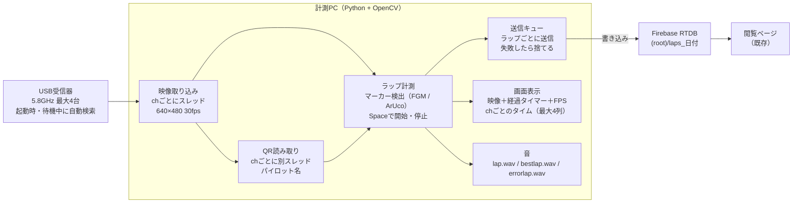

# d-practice-cam 仕様書

最終更新: 2026-11-08 ／ この仕様書が正本（claude.ai 上の旧仕様書は今後更新しない）

## 1. 概要

アプリ名は d-practice-cam（旧名 d-practice-mk。コードは `C:\USER\d-practice-cam`）。映像（cam）で計ることを名前にした。電波（RSSI）で計る方式は、QR でパイロット名を読めずシステムが大きく変わるので、作るなら別のアプリ（例: d-practice-rf）にする。Python + OpenCV で、FPVドローンの5.8GHzアナログ映像をUSB受信器で取り込み、
マーカー（FpvGateMarker。ArUco も可）の通過でラップを計測し、パイロット名とタイムをアナウンスするデスクトップアプリ。最大4台（4ch）を同時に計測する。

- **スタンドアローンが基本**: ネット無しで PC だけで動く（計測・音・アナウンス・画面のタイム・ランキング）。README（英語の `README.md` と日本語の `README_jp.md`）・公開用の exe もこの前提で、Firebase には触れない。
- **Firebase への送信は隠し機能**: exe の隣に `firebase.yaml` と鍵を置いたときだけ動く（`docs/firebase.md`、3.6・5章）。置いていなければ、画面にも設定画面にも Firebase・ルート・鍵の項目を出さない。

- **参考元**: [TinyViewPlus](https://github.com/t-asano/tinyviewplus)（openFrameworks/C++、MITライセンス）。マーカー検出による周回判定、最大4画面の分割表示を参考にした。コードは流用せず Python で新規実装。
- **送信形式（隠し機能）**: 既存の lap2firebase（`C:\USER\lap2firebase\lap2firebase\lap2firebase.py`）と同じ形式で送り、今の閲覧ページをそのまま使えるようにする。
- **やらないこと**: レース管理（周回数・制限時間）、手動補正のうち周回の追加と、前後のラップをつなぐ修正（ミス計測のラップを無効にすることだけはできる。6章）、パイロット名の登録・管理（QRで読む以外）、セクタ計測。

## 2. システム構成



映像はch単位で独立に処理し、ラップが確定したらそのまま送信キューへ渡す。Firebaseへの送信（隠し機能。設定が無ければ送信キューは何もしない）は計測と切り離し、通信が止まっても計測は続く。

**ハードウェア**: Windows PC 1台、USB映像受信器 最大4台（UVC対応、各1ch固定）、ゲートに貼るマーカー（FGM は [fpv-gate-marker](https://github.com/chibaron/fpv-gate-marker) を参照。ArUco なら1辺120〜150mm目安）。
Windowsでは1つのUSBハブに複数の受信器をつなぐと動かないことがあるため、USBポート1つに受信器1台を推奨。

## 3. 機能要件

### 3.1 映像受信

- **受信器の検索**: 起動直後に接続中の映像デバイスを列挙し、デバイス名が `config.yaml` の `receiver.device_names` に一致（部分一致、大文字小文字無視、複数指定可）するものを最大4台、ch1〜ch4に割り当てる（[TinyViewPlusマニュアル](https://github.com/t-asano/tinyviewplus/blob/v0.9.33-beta2/README_ja.md)参照）。
  - PC内蔵カメラなど名前が一致しないデバイスは除外する。
  - 割り当て順はデバイスパス（USBポート）順。毎回同じ順になる。
  - デバイス名の取得には `cv2-enumerate-cameras` を使う（OpenCV単体では名前が取れない）。
- **自動再検索**: 待機中は `receiver.auto_scan_sec`（既定3秒、0で無効）ごとに受信器の抜き差しを確認し、組み合わせが変わっていれば自動で検索し直す。計測中は再検索しない。見つからないときはその旨を表示し、つながれば自動で表示する。Rキーで手動再検索もできる。
- **取り込み**: 640×480、目標30fps、DirectShow。受信器ごとに独立したスレッドで取り込みとマーカー検出を行い、画面描画が遅れても取りこぼさない。
- **途切れ**: 1.5秒フレームが来ないchは「NO SIGNAL」を表示し、同じ受信器への再接続を自動で試みる。

### 3.2 バンド

- 各chにはバンド名（例: F1、E1）を割り当てる。QRでパイロット名を読んでいないchは、ラップをバンド名で記録する（3.7）。
- 待機中に **1〜4キー** または **映像のクリック** で、そのchの受信器のバンドを変更できる（R/F/E/A/B/L の1〜8から選択、直接入力も可）。
- 変えたバンドは受信器のデバイスパス（つないでいるUSBポート）ごとに `config.yaml` の `receiver_bands` に保存する。抜き差しでchの並びが変わってもバンドは入れ替わらない。保存の無い受信器は `channels` のch番号順の既定値を使う。
- 周波数の切替は受信器側で行い、アプリは制御しない。

### 3.3 周回検出（FGM / ArUcoマーカー）

- マーカーは2種類から選ぶ（`aruco.marker_type`、既定 `fgm`）。**基本は FGM**（`fgm`。FpvGateMarker、3.3.1）。TinyViewPlus と同じ ArUco マーカー（`aruco`、3.3.2）も使える。旧名はバーマーカー（`marker_type: bar`・`bar_*` の config.yaml も FGM として読む）。設定のまとまりの名前は互換のため `aruco:` のまま。
- ゲートは1つのみ（スタート＝フィニッシュ）。その周囲にマーカーを貼り、機体カメラの映像にマーカーが映ってから消えた時点を「ゲート通過」とする（詳細は4章）。
- 誤検出対策として、最小マーカーサイズ、同時に必要なマーカー数（ArUco のみ）、見えてからの確定待ち時間、消失後の確定待ち時間、最小ラップ（`minLap`）を設定できる。

#### 3.3.1 FpvGateMarker（FGM）

**FGM のマーカー（画像・寸法・作り方・貼り方）と検出の仕様は [fpv-gate-marker](https://github.com/chibaron/fpv-gate-marker) を参照**（このアプリには書かない）。
このアプリは、そのパッケージ `fgm` の `FgmDetector` を ch ごとに1つ作って使う（`requirements.txt` で GitHub `chibaron/fpv-gate-marker` のコミットを固定して入れる）。
「見えた」「見えない」は `FgmDetector` の結果をそのまま使い、通過の判定（4章）に渡す。

#### 3.3.2 ArUco マーカー（`marker_type: aruco`）

- 辞書は `DICT_4X4_50`、使うマーカーIDは 0〜3 に固定（TinyViewPlus と同じ。設定は無い）。1辺120〜150mm目安。
- 印刷用画像はこのアプリでは作らない・同梱しない（マーカーは TinyViewPlus と同じなので、そちらのものを使う）。
- **マーカーは TinyViewPlus と共通**。TinyViewPlus の `data/system/marker.xml`（4×4ビット、4種）のビット列は、`DICT_4X4_50` の ID 0〜3 と回転なしで一致する（黒枠1マスも同じ）。TinyViewPlus 用のゲートのマーカーをそのまま使える。

### 3.4 計測の開始と停止

- 起動して受信器の検索が終わると **待機中** になる。待機中は映像とマーカーの検出枠を表示するだけで、ラップは計測しない（ゲート位置の確認用）。
- **Spaceキー** で計測を開始し、もう一度押すと停止して待機中に戻る。
- 計測中は、ゲートを通過するたびに直前の通過からのラップを計測し、すぐデータベースへ送信する。

### 3.5 音

- 待機中から計測中になったとき（Spaceで計測開始）に `sound/boot.wav` を鳴らす（上がる和音の起動音。停止では鳴らさない）。
- ラップが確定すると `sound/lap.wav` を鳴らし、続けて「パイロット名、タイム」をアナウンスする（3.7）。そのパイロットの当日のベストラップを更新したラップ（ランキングの BEST LAP と同じ判定。その日の最初のラップも更新。60秒以上のラップも）では、`lap.wav` の代わりに `sound/bestlap.wav` を鳴らす。
- `minLap` 以下で計測しなかった通過では `sound/errorlap.wav` を鳴らす。ただし前に数えた通過から3秒以下（`main.ERROR_SOUND_MIN`。固定）は、同じゲートの二重検出などなので鳴らさない（ログには無視したラップの秒数を出す）。
- 各chの最初の通過（起点）でも `sound/lap.wav` を鳴らし、続けて「〇〇、スタート」とアナウンスする（3.7）。待機中の通過では鳴らさない。
- 効果音（`lap.wav` = 上がる2音の「ピコン」、`bestlap.wav` = A5 の短い音3回と D6 を伸ばす「ピッ・ピッ・ピッ・ポーン」（`sound/sample_bestLap.wav` の音の並びを参考に作った。サンプルは Git の管理外で exe にも入れない）、`errorlap.wav` = 低い「ブブッ」、`boot.wav` = 上がる和音）は `tools/make_sounds.py` が正弦波・矩形波から作ったもの（ほかの音源は使っていない。以前は lap2firebase の出どころの分からない wav を使っていたので作り直した）。頭に無音を入れず、すぐ鳴る。別スレッドで順番に鳴らし、計測と画面を止めない。wav が無ければビープ音。`sound.enabled: false` で消せる。
- QRで新しいパイロット名を読んだら「〇〇、エントリー」とアナウンスする（3.7）。アナウンス中に lap 音・errorlap 音が来たら、アナウンスを止めて（残りは捨てて）音を先に鳴らす。

### 3.6 クラウド送信（Firebase Realtime Database、隠し機能）

- **隠し機能**: `firebase.yaml`（`database_url`）と鍵の両方があるときだけ動く。どちらか無ければスタンドアローン（`FirebaseSync.local`）で、画面上部に Firebase の状態もルートも出さず、設定画面にもルート・鍵の項目を出さない。ログにも Firebase やルートのことを出さない（`firebase.yaml` を置いたのに使えないときだけ、原因を警告で出す）。README と公開用の exe（`--public`）には Firebase の説明・ひな形（`docs/firebase.md`・`firebase.example.yaml`）を入れない。
- ラップが確定するたびに、lap2firebase と同じ形式で1件ずつ追記する（構造は5章）。
- 送信は別スレッドのキューで行い、通信の遅れで計測を止めない。
- **オフライン**: 計測・音・アナウンス・画面はネット無しで動く（コース設定は `config.yaml` の `track_setting` の値を使う）。送信は1回だけ試し、`firebase.timeout_sec`（既定10秒）で応答が無ければあきらめる。送れなかったラップは**再送しない**（ログに内容を残して捨てる）。画面上部は `Firebase: OFFLINE`（赤）。次の送信が通れば `OK` に戻り、日付ノードの確認（無ければ作成）と `!trackSetting` の購読をやり直す。
- `!trackSetting` は購読して常に最新値を使う。設定画面から値を変更して書き込める（6章）。

### 3.7 パイロット名（QRコード）

- ドローンを起動したときに映像（OSD）へ表示されるQRコードを読み、その文字列をそのchのパイロット名にする。以降そのchのラップは `pilotName` にパイロット名を入れて送る。
- QRは待機中も計測中も探す。マーカーの検出とは別のスレッドで `qr.interval_ms`（既定500ms）ごとに最新フレームだけを読むため、取り込み・マーカー検出のフレームレート（30fps）は落とさない。QRの読み取りには `cv2.QRCodeDetector` を使う（640×480で1回 約10〜20ms）。
- 別のQRを読んだらその名前に置き換える。
- ゲート通過（待機中・計測中、`minLap` 以下を含む）もQRの読み取りも `qr.pilot_timeout_sec`（既定60秒、0でしない）無ければ、パイロット名を外してバンド名に戻す（計測の起点もリセットする。下の「通過が無いときのリセット」）。
- パイロット名は制御文字を除き、前後の空白を取って最大32文字。アプリを終了すると消える（`config.yaml` には保存しない）。受信器の再検索では同じ受信器（デバイスパス）の名前を引き継ぐ。
- 画面にはバンド名の横に `F1:TARO` の形でパイロット名を出す（英数字以外は `?` で表示。Firebase には元の文字のまま送る）。読み取ったQRは水色の枠で示す。
- `qr.enabled: false` で無効にできる。
- **通過が無いときのリセット**: 最後のゲート通過（マーカーの検出。`minLap` 以下の通過とQRの読み取りも含む）から `qr.pilot_timeout_sec`（既定60秒、0でしない）たったら、パイロット名の有無にかかわらず、そのchの計測の起点をリセットし（次の通過が起点 `999` =「スタート」）、パイロット名があればバンド名に戻す。経過タイマーの表示も `--.--` に戻す。このとき「バンド、クリア」をアナウンスする（lap2firebase と同じく `F1_clear.wav` などバンドごとの wav。無いバンドは音声合成で `speech.clear_text`、既定 `{band}、クリア`）。
- **起点のリセット**: **新しいQR**を読んだら、そのchの通過判定と前回通過時刻をリセットし、次のゲート通過を起点（`999`）にする。計測中も待機中も行い、経過タイマーの表示も `--.--` に戻す。新しいQRとは、別の名前のQR、または**3秒以上QRが見えていなかった後に読んだQR**（機体を起動し直した。同じ名前でも、`pilot_timeout_sec` の60秒以内でもリセットする）。QRが表示されている間の読み直し（500msごと）ではリセットしない。新しいQRでは「〇〇、エントリー」もアナウンスする。
- **流れ**: QRを読む →「〇〇、エントリー」→ 起点をリセット → ゲート通過（起点 `999` を送信）→ lap 音 →「〇〇、スタート」→ 以降は通常のラップ。
- **周回数・トータルのアナウンス**: `!trackSetting` の `totalLapAnnounce` が true なら、周回ラップのタイムに続けて「○周」「トータル○秒」をアナウンスする（lap2firebase と同じ。`lap3.wav` → `total35.wav`）。周回数は起点（スタート）からの周回数（`minLap` 以下の通過は数えない）、トータルは起点からの経過秒（整数に切り捨て）。起点のリセット（計測開始・新しいQR・通過が無いとき）で0に戻る。アプリ内でだけ数え、Firebase には送らない。wav は `lap1`〜`lap99`、`total0`〜`total599` なので、範囲外はその部分だけ省く。音声合成では `speech.total_text`（既定 `{lap}周、トータル{total}秒`）をタイムの後に続ける。
- **ベストラップ更新のアナウンス**: 周回ラップがそのパイロット（`pilotName`。QR を読んでいない ch はバンド名）の当日のベストラップを更新したら（ランキングの BEST LAP と同じ判定。その日の最初のラップも更新、同じタイムは更新しない）、周回ラップのアナウンスの**最後**（周回数・トータルの後）に「ベストラップ更新」を付ける。wav は lap2firebase と同じ `newbest.wav`（`sound/voice`）、無ければその部分だけ音声合成で `speech.best_text`（既定 `ベストラップ更新`、英語は `new best lap`）。60秒以上のラップはアナウンスしないので付けない。
- **周回ラップのアナウンス**: ラップが確定したら、lap 音の後に「パイロット名 → タイム」をアナウンスする（lap2firebase と同じ）。タイムは0.1秒単位に切り捨て（11.06秒 → `110.wav`「11.0」）。**60秒以上のラップはアナウンスしない**（lap 音だけ）。タイムの wav は `50.wav`〜`598.wav`（5.0〜59.8秒）なので、それ以外のタイムや `名前.wav` が無い名前は音声合成で `speech.lap_text`（既定 `{name}、{time}`）を読む。
- **アナウンス**: 新しいQRを読んだとき（別の名前、または起動し直して同じ名前のQRがまた出たとき）に1回だけ「エントリー」、起点の通過では lap 音の後に「スタート」をアナウンスする。同じQRを読み直しても繰り返さない。待機中・計測中とも行い、lap 音・errorlap 音が来たら止めて残りは捨てる（3.5）。QRを読んでいないchの起点はバンド名でアナウンスする。
  - **声は lap2firebase の wav（VOICEVOX）に揃える**: `sound/voice`（固定で設定は無い。exe の隣。lap2firebase の `wav/` から wav をコピーしたもの、約71MB・Git管理外）に `名前.wav` と `entry.wav` / `start.wav` があれば、lap2firebase と同じく「名前.wav → entry.wav」「名前.wav → start.wav」と鳴らす。バンド名（`F1.wav` など）も同じ。2つの wav は1つにつないでから1回で鳴らす（別々に鳴らすと、非同期再生の鳴り始めの遅れで名前の終わりが切れるため）。次の音までは0.3秒余分に待つ。決まった言葉（`entry`・`start`・タイム・周回数・トータル・バンド名・`バンド_clear`）は `sound/voice`、パイロットの `名前.wav` は `speech.pilot_dir`（既定 `./sound/pilot`。人の名前なので Git の管理外。公開用には、日本語版の zip に `CHO!`・`GORI`・`KUMACHAN` の3つ（`tools/build_exe.py` の `PUBLIC_PILOTS`、VOICEVOX で作ったもの）だけ入れる）に分けて置く。名前.wav は pilot_dir → `sound/voice` の順に探す（バンド名の `F1.wav` や、前の置き方の名前も鳴る）。 wav は Git に入れず（公開用の日本語版 zip にだけ入れる）、`tools/make_voice.py` で VOICEVOX から作り直せる（`app.sound.voicevox_synth` と同じ声・速さ。ラップ 5.0〜59.9秒、`lap1`〜`lap99`、`total0`〜`total599`、entry・start・newbest、設定画面で選べる全バンドの名前と `_clear`）。
  - **パイロットの名前.wav はユーザーが作って置ける**: 同じ声で読ませたいパイロットは、ユーザーが VOICEVOX（四国めたん。lap2firebase の `createwav.py` と同じなら `speaker: 2`、`speedScale` 1.2、16bit モノラル 24kHz）で `名前.wav` を作って pilot_dir に置く。名前はそのまま読ませる（読み方の辞書は持たない）。
  - **無い名前は、VOICEVOX が起動していれば VOICEVOX で作る**: 名前.wav がどちらにも無いアナウンスが来たとき、この PC で VOICEVOX のエンジンが起動していれば（`http://127.0.0.1:50021` の `/version` に1秒以内に答える。`sound.voicevox_synth`）、その HTTP API（`audio_query` → `synthesis`）で名前を読ませた wav を `pilot_dir/名前.wav` に保存する。声は `sound/voice` と同じ四国めたん ノーマル（`speaker: 2`）、`speedScale` 1.2、16bit モノラル 24kHz。URL・声・速さは固定で設定は無い。起動していない・作れないときは、下の Windows の声で作る（起動していないのはふつうのことなのでログに出さない）。アプリから VOICEVOX を起動することはしない。
  - **VOICEVOX が無ければ Windows の声で作る**: VOICEVOX で作れなかったら、音声合成（SAPI）の声（`speech.voice`、空なら日本語の声）で名前を読ませた wav を `pilot_dir/名前.wav` に保存し、ほかと同じく `名前.wav → entry.wav` などをつないで鳴らす。形式は `sound/voice` と同じ 16bit モノラル 24kHz（`SpFileStream`）。SAPI の wav は前後の無音が長いので、`sound/voice` の VOICEVOX の wav に合わせて前0.1秒・後0.09秒を残して切る。保存した後はユーザーが置いた wav と同じ扱い（VOICEVOX の声にしたいときは、ユーザーが作って上書きするか、wav を消す）。作るのは別スレッドで、lap 音・計測は待たせない（その名前のアナウンスは作り終わるまで待ち、順番は入れ替えない。COM はそのスレッドで作る）。日本語音声パック（`sound/voice`）が無いときは作らない。作った wav は使う人の PC の中だけで使い、公開用の exe・zip には入れない（Windows の声の出力を配ってよいかは、Microsoft の正式な条件が見つからないため）。
  - **wav が無い名前**（日本語音声パックが無い、Windows の声でも作れない、`名前.wav` が無い、名前にファイル名に使えない文字がある）は、Windows の音声合成（SAPI、`comtypes` 経由）で文を読み上げる。文は `speech.text`（既定 `{name}、エントリー`）と `speech.start_text`（既定 `{name}、スタート`）。`{name}` はパイロット名、`{band}` はバンド名。
  - 音声合成の声は `speech.voice`（声の名前の一部、例: `Haruka`。空なら日本語の声）。名前はそのまま読む（読み方の辞書は持たない。正しく読ませたい名前は lap2firebase で wav を作る）。
  - `speech.enabled: false` でアナウンスだけ止められる。
  - **アナウンスの言語**: `speech.language` で `en`（既定）と `ja` を選ぶ。項目が無い `config.yaml` も英語になる。`en` は wav を使わず、音声合成だけで `speech.en` の文（既定 `{name}, entry` / `{name}, start` / `{name}, {time}` / `lap {lap}, total {total} seconds` / `{band}, clear` / `new best lap`）を読む。声は `speech.en.voice`（空なら英語の声）で、英語の声が無ければそのときの声のまま読む。英語の wav は作らない。`speech` の上の階層の文と声は日本語用で、言語を切り替えても消えない。

### 3.8 LapRF プロトコルでの通知

ゲート通過を LapRF プロトコルで外に知らせ、LiveTime などの LapRF に対応したソフトで受けられるようにする（既定はオフ。TinyViewPlus_Livetime v012 と同じ機能で、コードは流用せずプロトコルだけ合わせた）。実装は `app/laprf.py`。

- **接続**: アプリが TCP サーバーになる（ポートは 5403 に固定で、設定は無い。全インターフェースで待ち受け、複数接続可）。オンのときは Windows のファイアウォールの確認が出ることがあるので、`laprf.enabled` の既定はオフ。ポートを開けなければログに警告を出し、計測は続ける。
- **パケット**: `0x5a, 長さ(2), CRC(2), メッセージID(2), [フィールドID(1), サイズ(1), 値]..., 0x5b`（リトルエンディアン）。長さは 0x5a から 0x5b までのバイト数。CRC は CRC-16/ARC で、CRC 欄を0にして全体から計算する。0x5a と 0x5b の間の 0x58〜0x5f は `0x5c, 値+0x40` に置き換える。
- **通過（`0xDA09` DETECTION）**: ラップ確定で全クライアントに送る。計測中（Space で開始した後）だけで、起点の通過も送る。`minLap` 以下の通過は送らない。フィールドは DECODER_ID(0x20)、PILOT_ID(0x01、ch+1)、DETECTION_NUMBER(0x21、スロットごとの通し番号で、起点のリセットでは戻さない)、RTC_TIME(0x02、最後に見えたフレームの時刻のマイクロ秒)、PEAK_HEIGHT(0x22)、FLAGS(0x23)。
- **問い合わせへの返事**: `0xDA08`（DESCRIPTOR）、`0xDA02`（RF_SETTINGS。8スロット分を1パケットずつ）、`0xDA0C`（TIME。RTC_TIME と同じ `time.monotonic()` のマイクロ秒）。設定の書き込みには従わず、いまの設定を返す（バンドはアプリ側で決める）。
- **定期送信（`0xDA0A` STATUS）**: 1.5秒ごと。
- **バンド**: 受信器の ch をスロット1〜4に割り当て、バンド名から番号・ch・周波数を返す。番号は L=0, F=1, R=2, E=3, B=4, A=5（F・E・A は TinyViewPlus_Livetime の値。R・B・L は LapRF の App の表の順番から求めた値で、実機での確認はしていない）。受信器の無いスロットや、分からないバンド名は無効（ENABLE=0）で返す。
- **固定の値**: DECODER_ID、PEAK_HEIGHT、GAIN、THRESHOLD、電池電圧、RSSI などは TinyViewPlus_Livetime と同じ固定の値（検出には使っていない）。
- 送信は専用スレッドで行い、取り込みスレッドを待たせない。1秒で送れないクライアントは切る。

### 3.9 映像が無いとき（砂嵐）

アナログ受信器は電波が無くてもフレームを出し続けるので、映像の中身で判定する（`app/video_monitor.py`。4画素おきに間引いて1回約1ms）。計測中も待機中も行う。`no_video.enabled: false` で行わない。

- **調べる間隔**: マーカーの処理を優先するため、映像がある間は1秒ごと、映像が無い間（マーカーを探さない）は0.1秒ごと。フレームはコピーせず、続いた2フレームを比べる。
- **判定**: **砂嵐** = 上下の行の差とフレーム間の差の平均が両方40以上。**単色の画面**（受信器の青画面・黒画面）= 輝度の標準偏差が15未満で、彩度の平均が200以上か輝度の平均が16未満（白っぽい空などは映像無しにしない）。フレームが読めないときも映像無しとする。基準値は手元の受信器2機種と合成画像で決めた（実際の飛行の映像、ほかの受信器では未確認）。
- **マーカー検出を止める**: 映像が無いと分かった後はマーカーも QR も探さない（画面の緑の枠も出ない）。砂嵐になってから分かるまでの最大1秒は、マーカーを探し続ける。通過の判定は「マーカーが見えない」として続けるので、マーカーが見えたまま砂嵐や青画面になると、消失待ちの後に通過になる。
- **クリア**: 映像が無い状態が `no_video.clear_ms`（既定3000ms、0でしない）続いたら（映像が無いと分かった時刻から数えるので、映像が無くなってから最大で約4秒）、通過が無いときのリセット（3.7）と同じくクリアする。起点とパイロット名を消し、「バンド、クリア」をアナウンスする。1回映像が戻れば数え直す。パイロットも起点も無い ch はアナウンスしない。短い砂嵐ならセッションは続く。

## 4. 周回検出アルゴリズム

マーカーが「見えた」後に「一定時間見えなくなった」瞬間をゲート通過とし、その時刻は最後にマーカーが見えたフレームの時刻とする。
マーカーが一瞬読めなかっただけで早すぎる周回が記録されるのを防ぐため、消失後に待ち時間を置く（TinyViewPlusと同じ考え方。[解説記事](https://qiita.com/zubon2003/items/9fc0ef3fb804d6576d12)）。

chごとに次の状態機械を持つ。

1. **未検出 (IDLE)**: 有効なマーカーが `appear_ms`（既定30ms、0ですぐ）続けて映ったら SEEN へ（途中で途切れたら数え直す。短い誤検出では通過にならない）。30fps（約33ms間隔）では、2フレーム続けて見えれば SEEN になる（1フレームだけの検出は無視）。最後に見えた時刻 `t_last` を記録。
2. **検出中 (SEEN)**: マーカーが見え続ける間 `t_last` を更新。見えなくなったら LOST へ。
3. **消失待ち (LOST)**: `flicker_ms`（既定200ms）以内に再び `appear_ms` 続けて見えたら SEEN に戻る。経過したら通過を確定し IDLE へ。見え続けているかを数えている間は確定を待ち、`appear_ms` に満たなければ誤検出として `t_last` を変えずに確定する。画面の緑の枠はこの待ちを通さず、フレームごとの検出結果を出す。
4. **通過確定**: `lap = t_last − 前回通過時刻` を秒で求め、10ms未満を切り捨て、999秒以上は999にする。`minLap` 以下なら無視（前回通過時刻も更新しない）。chの最初の通過は前回時刻が無いため `999` となり、lap2firebase と同じく周回の起点として送る。計測開始時に各chの状態はリセットする。QRで新しいパイロット名を読んだときもそのchの状態をリセットする（3.7）。

**有効な FGM の条件**（`marker_type: fgm`、既定）

`FgmDetector` に `fgm_line_step`（既定4px）、`fgm_min_lines`（既定3）、`min_size_pct`（既定5%）、`fgm_tol`（縞の間隔のずれの許容、既定0.25マス）を渡し、その「見えた」をそのまま使う。条件の詳細は [fpv-gate-marker](https://github.com/chibaron/fpv-gate-marker) の仕様。
検出枠は、見つかった FGM ごとに出す（片方だけでも枠は出るので、ゲートの調整に使える）。

**有効な ArUco マーカーの条件**（`marker_type: aruco`）

- 設定したIDに含まれる。
- マーカーの一辺がフレーム高さの `min_size_pct`（既定5%）以上（遠くのゲートの誤反応を防ぐ）。
- 同一フレームで `min_markers`（既定1）個以上見えている。

**時刻**: ラップはフレーム取得直後に `time.monotonic()` で取ったPC時刻の差分で求める（同一PC内の差分なので時計合わせ不要）。
Firebase の `time` には通過時のPCのローカル時刻を `HH:MM:SS` で入れる。計測の分解能は1フレーム（30fpsで約33ms）。

## 5. Firebase Realtime Database データ構造

既存の lap2firebase と同じ形式で書き込む。日付ごとのノード `{root}/laps_YYYY-MM-DD` の下に、ラップを1件ずつ `push()` で追記する。

- **書き込み先のルート `{root}`** は設定で変えられる（既定 `practice`）。設定画面で変えると `firebase.yaml` に保存され、次の計測開始から反映する。計測中は変更できない。
- **日付ノードの作成**: 起動時と計測開始時に、PCのローカル日付で `{root}/laps_YYYY-MM-DD` を確認する。無い場合（または `!trackSetting` だけ無い場合）は `config.yaml` の `track_setting` の値で `!trackSetting` を書き込んで作る。既にあるノードや設定は上書きしない。

```json
{
  "practice": {
    "laps_2026-10-31": {
      "!trackSetting": { "minLap": 10, "betterLap": 1.07, "...": "既存の設定" },
      "{pushId}": { "time": "14:05:12", "pilotName": "F1", "lapTime": 999 },
      "{pushId}": { "time": "14:05:27", "pilotName": "F1", "lapTime": 15.64 },
      "{pushId}": { "time": "14:05:31", "pilotName": "TARO", "lapTime": 14.23 }
    }
  }
}
```

日付ノードの下には、設定ノード（`!` 始まり。`!trackSetting`・`!band_status`・`!pilot`）と、push で追記されたラップが並ぶ。

| キー | 型 | 内容 | 本アプリ |
| --- | --- | --- | --- |
| laps_YYYY-MM-DD | node | PCのローカル日付。無ければ新規作成する | 作る・書く |
| time | string | 通過時刻（ローカル時刻 `HH:MM:SS`） | 書く |
| pilotName | string | QRで読んだパイロット名。読んでいない・期限切れのchはバンド名（例: E1、F4）。キー名は互換のため `pilotName` のまま | 書く |
| lapTime | number | ラップ（秒、小数2桁、10ms未満切り捨て、上限999）。999 は周回の起点 | 書く |
| !trackSetting | node | コースの設定。設定画面から全項目を編集できる。計測で使うのは `minLap`（秒）、アナウンスで使うのは `totalLapAnnounce` | 読む・書く |
| !band_status | node | バンド → パイロット名の対応 | 触らない |
| !pilot | node | lap2firebase.py には扱う処理がなく、他のプログラム（閲覧ページ等）が使うノードと思われる | 触らない |

**認証**: lap2firebase と同じく Admin SDK のサービスアカウント鍵で接続し、`databaseAuthVariableOverride` の uid に `python-script` を指定する。既存のセキュリティルールをそのまま使う。

**鍵の扱い**

- 鍵はサービスアカウントのJSONファイル（`serviceAccount.json`）。lap2firebase の鍵を流用できる。`config.yaml` には中身ではなくパス（`firebase.credentials`）だけを書く。
- 鍵ファイルは Git に入れず、アプリと一緒に配布しない（`.gitignore` 済み）。
- 鍵が漏れたときは、Firebaseコンソールの「サービスアカウント」でその鍵を削除して無効化し、新しい鍵を発行する。
- **Firebase の設定が無いとき**（`firebase.yaml` が無い・`database_url` が空・鍵 `serviceAccount.json` が無い・firebase-admin が無い）は、スタンドアローン（最初からオフライン）で動く。計測・音・アナウンス・画面・ランキングはそのままで、Firebase には何も送らない。画面上部には Firebase の状態を出さず、理由はログに出す。鍵の形式が違うなど接続できないときは `KEY ERR`（赤）。

## 6. 画面・操作仕様

メイン画面は接続した ch を横に並べた列にする（1〜4列）。各列の上に映像（4:3。高さは画面の55%まで）、下にその ch のタイムを出す。各映像の上に計測情報を重ねる。画面上の文字は英字（OpenCVの描画は日本語不可）。

**各chのタイム（映像の下）**: その ch の通過を新しい順に1行ずつ、`TARO  8.79  [13] 1:57.20`（左から `pilotName`、ラップ、起点からの周回数とトータル）の形で並べる。周回数とトータルは灰色。名前が列に入りきらなければ末尾を切る。起点（`999`）は `----HH:MM:SS----`（起点の通過の時刻。`ui.start_label`）で、セッション（起点から次の起点まで）の区切りになる。ランキングの BEST LAP に載っているラップ（パイロットごとの当日のベスト。全 ch 共通）を緑にする。通過時刻で見分けるので、同じタイムが2回あっても緑はランキングに載った方（先に出した方）だけ。別の ch で出したベストのときは、その ch の一覧には緑が無い。**3周連続と90秒の周回数の記録も一覧で分かるようにする**（パイロットごとの当日の記録。`ranking.compute` の印）: 3周連続の記録の3周は、ラップの右に縦線（`mark3` の色。ダークは水色）を付ける（3行つながる）。90秒の周回数の記録になった通過（その行の `[周回数] トータル` がそのまま記録）は、周回数とトータルを `mark90` の色（ダークはピンク）にする。ランキングのウィンドウの表の名前も同じ色（BEST LAP 緑、3周連続 `mark3`、90秒 `mark90`）で描き、凡例にする。無効にしたラップには付けない（記録が繰り上がれば印も移る）。`minLap` 以下の通過は出さない。当日の全ラップのファイル（下の「ラップの記録」）から受信器（USBポート）ごとに出すので、起動し直しても当日分が出て、検索し直して並びが変わっても入れ替わらない。日付が変わると空になる。**文字の大きさは固定**で、ウィンドウ（全画面なら画面）が高いほど多くの行を出す（1280×720 で 4ch なら15行、1920×1200 なら27行）。メイン画面はウィンドウの大きさで描き、上の帯と映像の段は 1280×720 の配置をウィンドウの幅に合わせて拡大縮小する（今までどおり大きくなる）。ウィンドウが横長すぎて一覧が3行（`ui.MIN_LIST_ROWS`）より少なくなるときは、上の段を縮めて中央に寄せる。入りきらない古い行は、その列の上でマウスホイールを回すとスクロールして見られる（3行ずつ。下へ回すと古い方。計測中もできる）。右端のスクロールバーでも動かせる（つまみをドラッグ、つまみの上下をクリックで1画面ずつ。計測中もでき、バンドの変更にはならない。細いのでバーの左10画素もクリックを受け付ける。`ui.scrollbar_hit`）。入りきらないときは右端にスクロールバーを出し、古い所を見ている間はつまみをオレンジ（`warn` の色）にする。古い所を見ている間は、新しい行が来ても表示をずらさない（上へ回して戻す）。表示位置は受信器ごとに持つ。

**ミス計測のラップの無効化**: タイムの一覧の行をクリックすると選び（オレンジの枠。もう一度クリックか、起点・空の行のクリックでやめる）、Delete キー（Backspace でも可）でそのラップを**無効**にする。無効のラップは一覧に残して灰色にし、横線で消す。もう一度 Delete で戻す。計測中・待機中のどちらでもできる。起点（区切り）は選べない。
- 無効にしたラップはランキングから外し、全ラップから計算し直す（ベストラップは2番目の記録が繰り上がる。緑もそのラップに移る）。3周連続はそのラップの所で途切れる（前後の周を合わせない）。90秒の周回数は、そのラップより前に90秒に届いていなければ、そのセッションを記録しない
- 一覧の周回数・トータル（`[13] 1:57.20`）は計測したときのまま変えない。前後のラップを1つにつなぐことはしない（誤検出でも見逃しでも同じ操作にする）
- Firebase・LapRF には送ったままで、取り消さない（隠し機能の Firebase も含め、外へは何もしない）
- 誤検出を減らすには `minLap` を見直す（3.3）

**ラップの記録**: `config.yaml` と同じフォルダ（exe なら exe の隣）の `laps/laps_YYYY-MM-DD.jsonl` に、当日の全通過（起点を含む。`minLap` 以下は除く）を1行1件の JSON で書き足す（`app.laplog.LapLog`）。書き足すだけなので、アプリが落ちてもそれまでの分は残る（書きかけの行は読むときに飛ばし、次の行は改行してから書く）。
- 通過の行: `{"wall": 通過時刻(time.time()), "rx": 受信器(USBポート), "band": "F1", "pilot": "TARO", "lap": 秒(999 は起点), "count": 起点からの周回数, "total": 起点からのトータル}`
- 無効化の行: `{"void": true/false, "rx": 受信器, "wall": そのラップの通過時刻}`。元の行は書き換えない（何を消したか後から分かり、戻せる）
- 起動時に当日のファイルを読み、タイムの一覧とランキングを作り直す。日付（PC のローカル日付）が変わったら新しいファイルに切り替える（一覧とランキングは空になる）。**前の日のファイルは消さない**（練習の記録。1日数百KB）
- Git の管理外（`.gitignore` の `laps/`）。自分の PC 用の exe を作り直しても消さず、公開用の exe には入れない。Firebase には送らない

**各chのオーバーレイ**

- バンド名（例: F1）。ch番号は出さない
- QRで読んだパイロット名はバンド名の横に `F1:TARO` の形で出す。読み取り中のQRは水色の枠
- 右下に経過時間のタイマー（計測中のみ。黄色）。最後に数えた通過（起点を含む）から数え上げ、通過で 0 に戻る。`minLap` 以下で無視した通過では戻さない（ラップと同じ）。60秒未満は `12.34`、以上は `1:05.30`（10ms 未満切り捨て）。起点の前（計測開始直後・リセットの後）は `--.--`
- FPS（取り込み・検出のフレームレート）: 28fps以上は緑、20fps以下は赤、その間は黄。NO SIGNAL のときは 0.0
- マーカーが「見えた」ときは映像の外周の枠とマーカーを緑で表示（ゲート調整の確認用）。マーカーを見つけたが「見えた」になっていないとき（FGM がまだゲートの組になっていない＝片方だけなど。条件は fpv-gate-marker。ArUco の `min_markers` に足りない）は、マーカーを黄色で囲み、外周の枠は出さない（この状態では通過にならない）

ラップ一覧の別ウィンドウ（Laps）は廃止した（タイムはメイン画面の映像の下に出す）。

**ランキングウィンドウ（Ranking）**: パイロット（`pilotName`。QR を読んでいない ch はバンド名）ごとのランキングを別ウィンドウに出す。3つの表を上から縦に並べ（ウィンドウの高さを3等分）、上から **BEST LAP**（ベストラップの速い順）、**FASTEST 3 CONSECUTIVE LAPS**（3周連続の合計の速い順。秒で表示。RotorHazard の "Fastest 3 Consecutive Laps" と同じ呼び方）、**MOST LAPS IN 90s**（周回数の多い順、同じならタイムの短い順。RC カーの結果と同じく `周回数/時間` の1列で `10/1:33.50` の形。見出しの秒数は `sessionTime1`）。1人が何回も飛んだときは、いちばん良い記録を使う。
- **3周連続**: 同じセッションの中で続けて飛んだ3周の合計がいちばん短いもの。どの続けて飛んだ3周でもよい（1〜3周目、2〜4周目、…）。セッションは ch の起点（`999`）から次の起点まで（新しいQR・通過が無いときのリセット・計測の停止で終わる）で、**セッションを跨いだ3周は無効**。`minLap` 以下の通過は数えず、その前後の周は続いているものとして扱う（ラップと同じ）。60秒以上のラップも数える。起点を見ていない ch は、次の起点まで数えない。無効にしたラップの所で途切れる。
- **90秒の周回数（MOST LAPS IN 90s。旧名 90秒耐久。英語の endurance は数時間のレースを指すので改名した。FPV の RotorHazard の "Most Laps in Fastest Time" と同じ順位の付け方）**: ch の起点（最初の通過 `999`）から数え、トータルが `!trackSetting` の `sessionTime1`（既定90秒。見出しの秒数もこれ）**以上になった最初の通過**までの周回数とトータル。90秒の時点で走っている周も、ゴールすれば1周に数える（例: 15秒×6周 = 90.00 は6周 90.00、14秒×6周 = 84.00 の次に 9.5 秒なら7周 93.50）。それより後の通過は耐久には数えない。耐久の秒数に届く前に起点がリセットされた（QR・60秒の通過無し）ものは記録しない。`minLap` 以下の通過は数えない（ラップと同じ）。起点を見ていない ch（日付を跨いだセッションなど）は、次の起点まで耐久を数えない。そのセッションで90秒に届く前のラップを無効にしたら、そのセッションは記録しない。耐久の秒数を変えると、当日の全ラップから計算し直す。
- **ベストラップ**: 当日の周回ラップ（起点 `999` と無効にしたラップは除く）のうち、いちばん速いもの。同じタイムなら先に出した方。
- **記録**: ランキングは保存せず、当日の全ラップ（「ラップの記録」）から計算する（`ranking.compute`）。起動し直しても当日分から同じ順位になり、日付が変わったら空になる。Firebase には送らない。
- 起動時に開き、K キーで開く/閉じる（× で閉じても K で開き直せる）。配色はメイン画面と同じダーク（地は濃い灰、パイロット名はバンド名と同じ黄色）。既定は縦長（460×900）で、ウィンドウの大きさで描き、各表に入りきらない順位は出さない。

**配色**: `display.theme` でダーク（`dark`、既定）と明るい配色（`light`）を選ぶ。T キーと設定画面（General の `Color theme`）でも切り替え、`config.yaml` に保存する。明るい配色は屋外の日光の下で読めるよう、白い地に黒い太字で、色の付いた文字は濃い色（ベストラップは濃い緑、ランキングのパイロット名は濃い青、STANDBY はオレンジ）。対象は映像の外（上の帯、映像の下のタイム、映像の入らない所、ランキングのウィンドウ）。映像に重ねる文字（バンド名・FPS・タイマー・NO SIGNAL）とマーカーの枠は、黒い縁取りで描くのでどちらの配色でも同じ色。

**描画の間引き**: メイン画面の描画は `display.fps`（30fps）を上限にする（映像は30fpsなので、それ以上描いても変わらない）。どれかの ch の取り込みFPS（映像の来ている ch だけ）が `display.fps_threshold`（28）を下回ったら、描画を `display.low_fps`（10fps）に間引き、CPU をマーカー検出に回す。全 ch が28以上の状態が3秒続いたら戻す。間引いている間は画面上部に `DISPLAY 10fps`（黄）を出す。取り込み・マーカー検出・ラップ計測（ch ごとのスレッド）とキー操作は間引かない。

**待機中の表示**: 映像の段の中央に半透明の帯で「PRESS SPACE TO START」と「STANDBY - laps are not recorded」を大きく出す（映像は透けて見える）。計測中は消す。

**バージョン**: 日付ベース（`YYYYMMDD`）。exe は作った日（公開用 zip の名前 `d-practice-cam_en_YYYYMMDD.zip` などと同じ）。`tools/build_exe.py` が Git 管理外の `app/_build_version.py` に書いて exe に入れ、作り終えたら消す。ソースから動かすときは最後のコミットの日付に `-dev`（git が無ければ `dev`）。メイン画面のウィンドウのタイトル（`d-practice-cam 20261110`）、待機中の帯の右下と受信器が無いときの画面（`d-practice-cam ver. 20261110`。全画面ではタイトルが見えないため）、設定画面のタイトル、起動時のログ、`--version` に出す。同じ日に作り直した exe は同じバージョンになる。

**画面上部**: 計測状態（STANDBY ／ RUNNING と経過時間）、キー操作のヒント。Firebase を使っているとき（隠し機能、3.6）だけ、Firebase接続状態（OK / OFFLINE と送信待ち件数 / KEY ERR）と書き込み先のルートも出す。スタンドアローン（設定が無い）ときは出さない。

**キーボード・マウス操作**

| キー | 操作 |
| --- | --- |
| Space | 計測の開始 / 停止 |
| 1〜4 / 映像をクリック | そのchの受信器のバンドを変更（待機中のみ） |
| R | 受信器の再検索（待機中のみ。通常は自動） |
| S | 設定画面（待機中のみ） |
| K | ランキングウィンドウを開く/閉じる |
| マウスホイール（タイムの一覧の上） | その ch のタイムをスクロール（計測中もできる） |
| タイムの一覧の行をクリック → Delete（Backspace） | そのラップを無効にする / 戻す（ミス計測。計測中もできる） |
| T | 配色の切り替え（ダーク / 明るい配色。`config.yaml` に保存。計測中もできる） |
| F | 全画面切替 |
| Esc | 全画面の解除のみ（**終了はしない**） |
| Q | 終了（ウィンドウの×でも終了） |

**設定画面（Sキー、Tk）**: 表示は英語のみ（ログも英語のみ。多言語の切り替えはしない）。General タブで ch1〜4のバンド、受信器のデバイス名、マーカーの種類（ラジオボタンで FGM / ArUco、既定 FGM）、最小マーカーサイズ、同時に必要なマーカー数（ArUco）、FGM を探す横線の間隔と本数、FGM の縞のずれの許容（`aruco.fgm_tol`、0以上）、見えてからの確定待ち（`aruco.appear_ms`、0以上）、消失後の確定待ち、周波数を解放（クリア）するまでの秒数（`qr.pilot_timeout_sec`。0以上、0で解放しない。QR をオフにしても効く）、映像が無いときにクリアするまでの時間（`no_video.clear_ms`。0以上、0でしない。3.9）、LapRF で通過を知らせるか（チェックボックス。ポートは 5403 に固定、3.8）を編集する。`firebase.yaml` があるとき（隠し機能）だけ、書き込み先のルートと鍵ファイルのパスの項目も出す。データベースURLは設定画面では扱わず、`firebase.yaml` に直接書く。
保存すると `config.yaml` に書き戻す。ルート名は `. $ # [ ] /` と空欄を受け付けない。鍵ファイルの変更は再起動後に反映。

**QR & Announcements タブ**: QRでパイロット名を読むか、QRを探す間隔（50ms以上）、アナウンスするか、アナウンスの言語（ラジオボタンで Japanese / English）、音声wavのフォルダ（Browse で選べる。日本語だけで使う）、音声合成で読むときのQRを読んだときの文・起点の通過の文・周回ラップの文・周回数とトータルの文・クリアの文（`{name}` `{band}` `{time}` `{lap}` `{total}` だけ使える）、音声合成の声（インストール済みの声から選択、空ならその言語の声）を編集する。文と声は選んでいる言語の分を出し、言語を切り替えると入れ替わる（入力中の値も両方の言語で保持して保存する）。
`Test QR` `Test start` `Test lap` `Test clear` で、保存前の設定で試す名前・タイムをアナウンスする（日本語は wav があれば wav、無ければ音声合成。英語は音声合成。アナウンスを止めていても鳴る）。QRの設定を変えたら受信器を開き直して反映する（パイロット名は引き継ぐ）。読み上げの設定は次の読み上げから反映する。

**コース設定タブ**: 現在値を編集して `config.yaml` の `track_setting` に保存する。Firebase を使っているとき（隠し機能）は、今日の日付ノードの `!trackSetting` の現在値を読み込み、保存すると `{root}/laps_YYYY-MM-DD/!trackSetting` へ変更した項目だけ書き込む（`config.yaml` の値は日付ノードに設定が無いときの初期値になる）。他の端末が変えた値は購読で即反映する。

| 項目 | 型 | 既定値 | 内容 |
| --- | --- | --- | --- |
| minLap | 数値（秒） | 10 | これ以下のラップは無視。本アプリの計測で使う |
| betterLap | 数値（倍率） | 1.07 | 閲覧側・音声向け。そのまま保存 |
| lapMeterMax | 数値 | 28 | 同上 |
| lapMeterPass1 | 数値 | 15 | 同上 |
| lapMeterPass2 | 数値 | 20 | 同上 |
| sessionLaps1 | 数値 | 4 | 同上 |
| sessionTime1 | 数値（秒） | 90 | 同上 |
| sessionTime2 | 数値（秒） | 0 | 同上 |
| totalLapAnnounce | 真偽値 | true | 周回ラップのアナウンスに周回数とトータルを付けるか。本アプリのアナウンスで使う |

既定値は lap2firebase.py が `!trackSetting` を初期化するときの値と同じ。上表以外の項目があっても消さない。

## 7. 非機能要件・設定ファイル

| 項目 | 目標 |
| --- | --- |
| 対応OS | Windows 10/11（第一対象） |
| Python | 3.11以上（ユーザー環境は 3.12） |
| 処理性能 | 4ch × 640×480 × 30fps で検出の取りこぼしなし |
| 計測の分解能 | 1フレーム（約33ms）。誤差はフレームレートに依存 |
| 遅延 | 通過からFirebase反映まで通常1秒以内（Firebase を使うとき） |
| 耐障害性 | ネット切断中も計測を継続する（その間のラップは送らない。復帰後のラップから送る） |

**配布（exe）**: `python tools/build_exe.py` で PyInstaller のフォルダ形式の exe（`dist/d-practice-cam/`、約300MB）を作る。Python の無い PC でも動く。`config.yaml`・ログ・`sound/` は exe の隣に置く。公開用（`--public`）は2つの zip にする。英語版 `dist/d-practice-cam_en_YYYYMMDD.zip` は日本語音声の wav（`sound/voice/`）を入れない。日本語版 `dist/d-practice-cam_ja_YYYYMMDD.zip` は英語版に `sound/voice/`（クレジットの README.txt 付き）と、`sound/pilot/` の `CHO!`・`GORI`・`KUMACHAN` の名前.wav を足したもの（ほかのパイロットの wav は入れない）。`config.yaml` は入れないので、初めて起動したとき（`config.yaml` が無いとき）に exe の隣の `sound/voice/` に wav があれば `speech.language` を `ja` にして作る（`Config.load`）。音声が無いときの日本語は音声合成で読み、VOICEVOX で名前の wav も作らない。自分の PC 用の exe には `sound/voice/` も入れる。Firebase の鍵は exe にも出力先にも入れず、使う PC で exe の隣に置く。普段はコンソールを出さず（ログはファイル）、`--debug`（`debug.bat`）で起動したときだけコンソールを出して DEBUG のログを表示する。 README の画像（`docs/images/`）も exe のフォルダと公開用 zip に入れる（README から相対パスで参照）。

**依存ライブラリ**: `opencv-contrib-python`、`numpy`、`PyYAML`、`firebase-admin`、`cv2-enumerate-cameras`、`comtypes`（読み上げ用、Windowsのみ）（`requirements.txt`）。設定画面は標準の tkinter。

**設定ファイル**（`config.yaml` と `firebase.yaml`）。Firebase の設定（`firebase:`）だけは同じフォルダの `firebase.yaml` に分けて保存する。どちらも PC ごとのファイルで **Git の管理外**（ひな形は `config.example.yaml` / `firebase.example.yaml`）。`config.yaml` は無ければ既定値で作る。`firebase.yaml` はアプリからは作らない（無ければスタンドアローンで動く。使うときは `firebase.example.yaml` をコピーして作る。あれば設定画面での変更を書き戻す）。設定画面・バンド変更で上書き保存される（コメントは消える）。書いていない項目は既定値で補う。`config.yaml` に `firebase:` が書いてあっても読まない（Firebase の設定は `firebase.yaml` からだけ読む。次に保存すると `config.yaml` から消える）。`database_url` の既定は空で、空のあいだはオフラインで動く。

```yaml
receiver:
  device_names:            # 受信器として採用するデバイス名（部分一致、複数可）
    - "USB2.0 PC CAMERA"
    - "USB Video"
  max_count: 4
  auto_scan_sec: 3         # 待機中に抜き差しを確認する間隔（秒）。0 で無効
receiver_bands: {}         # 受信器のデバイスパス → バンド（画面から変えると保存）
channels:                  # receiver_bands に無い受信器の ch 番号順の既定バンド
  - { band: "F1" }
  - { band: "F4" }
  - { band: "E1" }
  - { band: "A8" }
capture:
  width: 640
  height: 480
  fps: 30
display:                   # メイン画面の描画（取り込み・マーカー検出は間引かない）
  fps: 30                  # ふだんの描画の上限
  low_fps: 10              # 取り込みの FPS が fps_threshold を下回ったら、この fps に間引く
  fps_threshold: 28
  theme: dark              # 配色。dark（濃い地）/ light（白い地、日光の下で見やすい）。T キー・設定画面でも切り替える
aruco:
  marker_type: fgm         # fgm（FpvGateMarker、3.3.1）/ aruco（ArUco、3.3.2）
  dictionary: DICT_4X4_50  # ArUco のみ
  min_size_pct: 5
  min_markers: 1            # ArUco のみ
  fgm_line_step: 4          # FGM のみ（意味は fpv-gate-marker）
  fgm_min_lines: 3          # FGM のみ
  fgm_tol: 0.25             # FGM のみ。縞の間隔のずれの許容（マス、0以上）。小さいほど誤検出が減り、遠くのマーカーは読みにくい
  appear_ms: 30            # この時間続けて見えたら「見えた」とする（誤検出対策。30fps で1フレーム分）。0 ですぐ
  flicker_ms: 200
qr:                        # ドローン起動時のQRでパイロット名を読む
  enabled: true
  interval_ms: 500         # QRを探す間隔（マーカー検出とは別スレッド）
  pilot_timeout_sec: 60    # この秒数ゲート通過が無ければ次の通過を起点にし、バンド名に戻す。0でしない
track_setting:             # !trackSetting の初期値。コース設定タブで保存すると更新
  minLap: 10
  betterLap: 1.07
  lapMeterMax: 28
  lapMeterPass1: 15
  lapMeterPass2: 20
  sessionLaps1: 4
  sessionTime1: 90
  sessionTime2: 0
  totalLapAnnounce: true
sound:
  enabled: true
  lap: ./sound/lap.wav           # ラップ確定時
  best: ./sound/bestlap.wav      # ベストラップを更新したラップ確定時（lap の代わり）
  error: ./sound/errorlap.wav    # minLap 以下で計測しなかった通過
  boot: ./sound/boot.wav         # 計測開始
speech:                    # パイロット名のアナウンス
  pilot_dir: ./sound/pilot  # パイロットの名前.wav（Git の管理外）。ユーザーが VOICEVOX などで作って置く。無い名前は VOICEVOX が起動していれば VOICEVOX、無ければ Windows の声で作る
  enabled: true
  text: "{name}、エントリー"  # QRを読んだとき。{name} パイロット名、{band} バンド名
  start_text: "{name}、スタート"  # 起点の通過（lap 音の後）
  lap_text: "{name}、{time}"      # 周回ラップ（lap 音の後）。{time} は0.1秒単位
  total_text: "{lap}周、トータル{total}秒"   # 周回ラップの続き（totalLapAnnounce のとき）
  clear_text: "{band}、クリア"    # 通過が無くリセットしたとき（wav は バンド_clear.wav）
  best_text: "ベストラップ更新"   # ベストラップを更新したとき、周回ラップの最後（wav は newbest.wav）
  voice: ""                # 声の名前の一部（例: Haruka）。空なら日本語の声
  language: en             # アナウンスの言語。en / ja（en は wav を使わず音声合成だけ）
  en:                      # language: en のときの文と声。上の text などは日本語用
    text: "{name}, entry"
    start_text: "{name}, start"
    lap_text: "{name}, {time}"
    total_text: "lap {lap}, total {total} seconds"
    clear_text: "{band}, clear"
    best_text: "new best lap"
    voice: ""              # 空なら英語の声
no_video:                  # 映像が無い間はマーカーを探さず、続いたらクリアする（3.9）
  enabled: true
  clear_ms: 3000           # 0 でクリアしない
laprf:                     # 通過を LapRF プロトコルで知らせる TCP サーバー（3.8）
  enabled: false           # ポートは 5403 に固定
```

`firebase.yaml`（Git の管理外）:

```yaml
credentials: ./serviceAccount.json   # 鍵ファイルのパス（鍵の中身は書かない）
database_url: https://<プロジェクト>-default-rtdb.<リージョン>.firebasedatabase.app/
root: practice           # 書き込み先のルート
auth_uid: python-script
timeout_sec: 10          # 送信をあきらめるまでの秒数（オフライン）。送れなかったラップは再送しない
```

## 8. 開発状況・未決事項

**開発ステップ**

- [x] 受信器の自動検索（デバイス名の列挙とパターン一致）と映像表示
- [x] ArUco検出と検出枠の表示
- [x] FGM（左右2枚）の検出。設定で ArUco と切り替え
- [x] 既定のマーカーを FGM にした（ArUco も選べる）
- [x] ラップ計測状態機械、Spaceキーでの開始・停止
- [x] 4ch同時取り込み（スレッド化）と分割表示・オーバーレイ
- [x] Firebase送信（日付ノード作成、キュー。オフラインでは再送せず OFFLINE 表示）
- [x] 設定画面、バンド変更、FPS表示、音
- [x] QRコードでパイロット名を読む（別スレッド）
- [x] パイロット名の読み上げ（lap 音を優先）
- [x] アナウンスの声を lap2firebase の wav（VOICEVOX）に揃える（無い名前は音声合成）
- [x] 周回ラップのアナウンス（lap 音 → 名前 → タイム）
- [x] QRを読んだら起点をリセットし、起点の通過で「〇〇、スタート」
- [x] ランキング（ベストラップ、3周連続、90秒の周回数。当日の全ラップから計算する）
- [x] 当日の全ラップを laps/laps_YYYY-MM-DD.jsonl に残し、ミス計測のラップを無効にできる
- [x] LapRF プロトコルでの通知（LiveTime との接続は未確認）
- [x] 映像が無いときのマーカー検出の停止とクリア（実際の飛行での確認はこれから）
- [x] パイロットの名前.wav を sound/pilot に分ける（ユーザーが VOICEVOX で作って置く。無い名前は、VOICEVOX が起動していればアプリが VOICEVOX で作る）
- [x] 名前.wav が無いときは、Windows の声で名前.wav を作る（sound/pilot）
- [ ] 実機での長時間・4台同時の確認
- [ ] 実機のOSDに出るQRが、受信映像（アナログ・640×480）で読めるかの確認
- [ ] 閲覧用Webページ（既存の閲覧ページを使うなら不要）

**未決事項**: なし。同じ日付ノードに lap2firebase（LapRF経由）と同時に書き込む運用はないため、バンドの重なりは考えなくてよい。

## 参考

- [TinyViewPlus（GitHub）](https://github.com/t-asano/tinyviewplus)
- [LapRF Timing（Android、ImmersionRC）](https://github.com/ImmersionRC/LapRFTimingAndroidPublic): プロトコルの確認にだけ使う（ライセンスが明示されていないので、コードは流用しない）
- [TinyViewPlus マニュアル（README_ja）](https://github.com/t-asano/tinyviewplus/blob/v0.9.33-beta2/README_ja.md)
- [FPVTrackside ArUco計測のパラメータ解説（Qiita）](https://qiita.com/zubon2003/items/9fc0ef3fb804d6576d12)
- [TinyViewPlus As Sensors のマルチゲート対応（Qiita）](https://qiita.com/zubon2003/items/aac4dd9475f2b33875a7)
